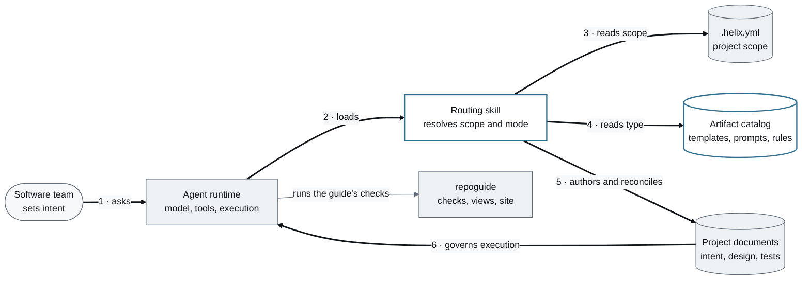
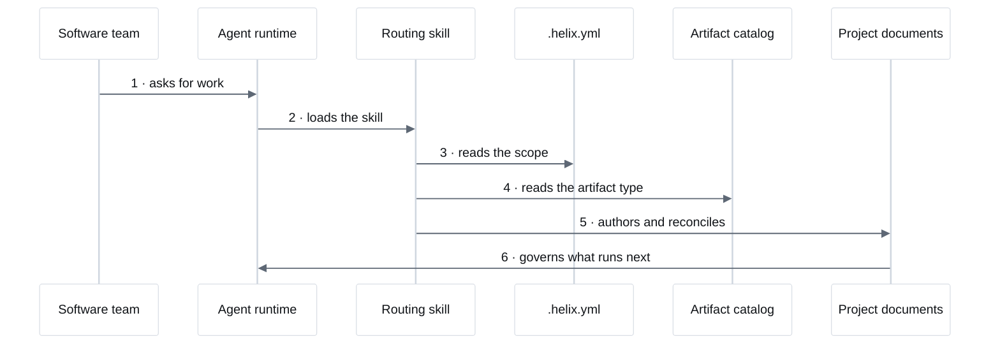

<!-- generated by `repoguide views` from the architecture model; do not edit -->
# Architecture

## Context

<!-- architecture-view: context -->

**HELIX in a repository.** The runtime acts; HELIX gives it a document discipline.

*Key: rounded = a person · blue outline = helix's code · gray = outside helix · dark numbered arrows = the request, in order. Generated by `repoguide build`.*

**Follow a request.**

1. **Asks.** A person asks the agent for work in their own words.
2. **Loads.** The host loads HELIX's one skill as a plug-in.
3. **Reads scope.** The marker says which flows are active and where each may write.
4. **Reads type.** The artifact type's template, prompt, and rules guide the work.
5. **Authors and reconciles.** The mode writes or aligns the governing documents.
6. **Governs execution.** Code implements the documented intent; it cannot silently redefine it.

<!-- /architecture-view -->

## Deployment

<!-- architecture-view: deployment -->

**Where HELIX runs.** One skill in the agent host, the record in your repository.

*Generated by `repoguide build`.*

<!-- /architecture-view -->

## Request

<!-- architecture-view: request -->

**A request becomes a governing document.** The runtime acts; HELIX gives it the scope, the shape, and the record.

<!-- /architecture-view -->

## Cast

<!-- architecture-view: cast -->

**The pieces.** Each piece does one job.

| Piece | Its job | Status |
|---|---|---|
| **Software team** | Decides what to build and approves what agents propose. | built |
| **Agent runtime** | Runs the model and its tools; Claude Code, Codex, Genie, or DDx. | built |
| **Routing skill** | Routes a request to a mode and binds the governing artifacts. | built |
| **Artifact catalog** | Holds every artifact type, its graph, the modes, and the voice profiles. | built |
| **.helix.yml** | Declares the flows, their roots, autonomy, and the guide's audiences. | built |
| **Project documents** | The system of record agents load and reviewers trace. | built |
| **repoguide** | Optional host tool: generates, checks, and assembles a repository's guide. | built |

<!-- /architecture-view -->
