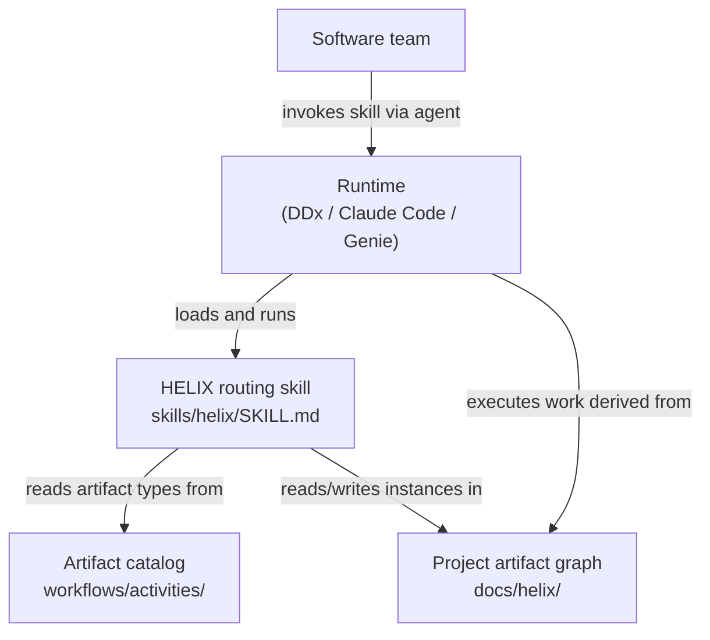
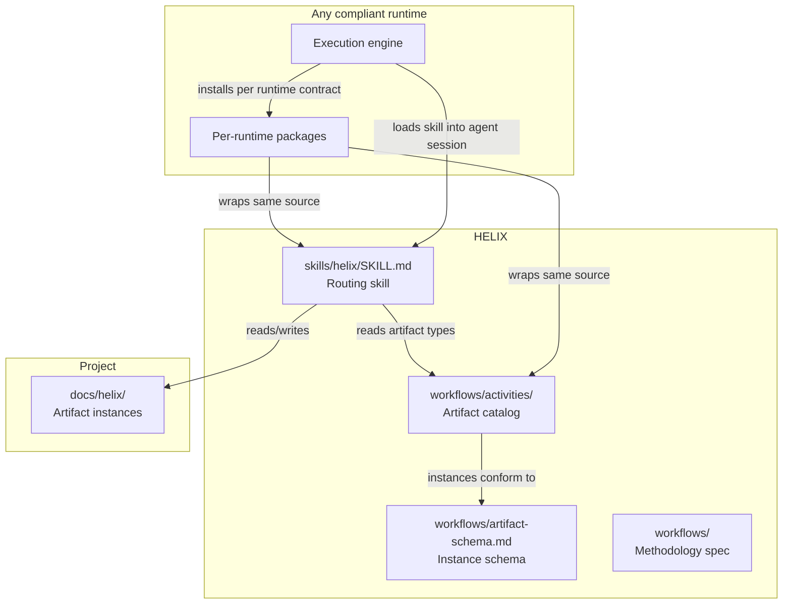
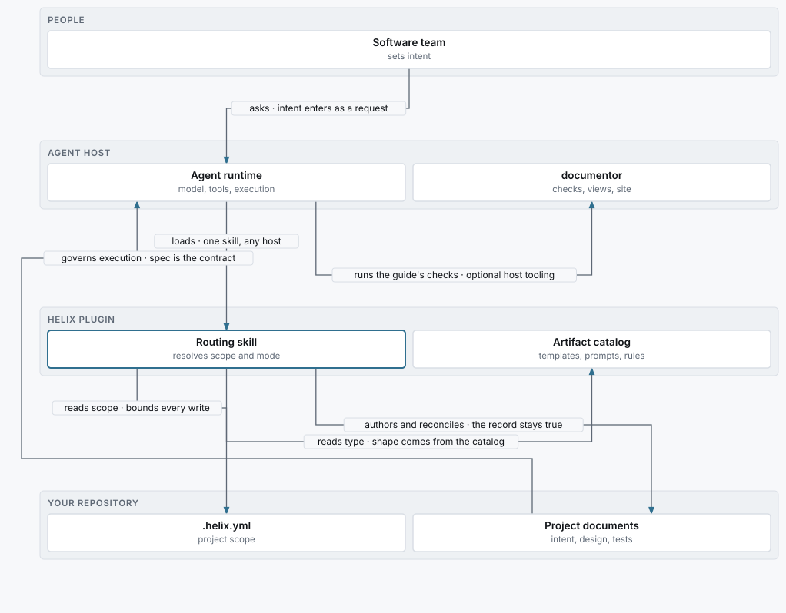

<!-- helix:publish audience=developer page=architecture kind=explanation voice=onboarding budget=1500 written=agent-opus reviewed=2026-10-20/agent-sonnet/a5bb26f7de8c31d9 -->
<!-- helix:source docs/helix/02-design/architecture.md#level-1-system-context sha256:20eaaf2abca95251 -->
<!-- helix:source docs/helix/02-design/architecture.md#level-2-container-diagram sha256:4d37f71ee8b0bb90 -->
<!-- helix:source docs/helix/02-design/architecture.md#artifact-schema-as-runtime-contract sha256:ca201550b5e7655b -->
<!-- helix:source docs/helix/02-design/architecture.md#packaging sha256:2ff820d456c362b4 -->
<!-- helix:source docs/helix/02-design/architecture.md#quality-attributes sha256:a7f863b67c0f0f9d -->
<!-- helix:source docs/helix/02-design/architecture.md#ddx-as-one-reference-runtime sha256:b5b467abedab6e0c -->
<!-- helix:source docs/helix/01-frame/prd.md sha256:87cd55c535e38bce -->
<!-- helix:source docs/install/README.md#what-you-get sha256:e50570f47c6119a5 -->
<!-- helix:source docs/install/README.md#no-fork-policy sha256:91bb66393b9e49f5 -->
<!-- helix:source scripts/sync_references.py sha256:019062c512836eb4 -->
<!-- helix:source .github/workflows/release-genie-bundle.yml sha256:1d738dd651805901 -->
<!-- helix:source .github/workflows/pages.yml sha256:531157c991907d82 -->
<!-- helix:source .github/workflows/documentor.yml sha256:d66814968e1608c1 -->
<!-- helix:source justfile sha256:d3e5861049a16f1f -->
# Architecture

## Context

HELIX is a methodology and artifact catalog that an agent runtime loads as a single routing skill. HELIX itself never runs as a program. A team asks its runtime for work, the runtime loads the skill, and the skill reads and writes the project's governing documents.



| Element | Type | Purpose |
|---------|------|---------|
| Software team | Human | Authors governing artifacts, approves plans, and steers alignment |
| HELIX routing skill | This system | Is the single entry point for routing, alignment, planning, and review |
| Artifact catalog | This system | Holds the canonical artifact type definitions |
| Project artifact graph | Per project | Holds instances of HELIX artifact types for one project |
| Runtime | External | Runs skill sessions and owns tracker, queue, evidence, and packaging |

HELIX has no CLI, tracker, queue, or execution loop. Those belong to the runtime. [CONTRACT-003](../../helix/02-design/contracts/CONTRACT-003-ddx-adapter-boundary.md) sets the boundary between HELIX content and a runtime.

DDx is the reference runtime for HELIX's own development, not the center of the architecture. HELIX uses DDx for bead tracking, `ddx work` dispatch, and execution evidence, the same way any adopter uses its chosen runtime.

## Containers

HELIX has four containers of its own: the skill, the catalog, the instance schema, and the methodology spec. Runtime packages and the execution engine sit outside them.



| Container | Technology | Responsibility |
|-----------|------------|----------------|
| `skills/helix/SKILL.md` | Markdown with skill frontmatter | Is the single agent-facing surface for every workflow mode |
| `workflows/activities/` | Markdown and YAML | Defines each artifact type with a template, prompt, `meta.yml`, and example |
| `workflows/artifact-schema.md` | Markdown spec | States the normative schema for `meta.yml` and `ddx:` frontmatter |
| `workflows/` (non-activity files) | Markdown | Holds principles, concerns, activity contracts, and alignment guidance |
| `docs/helix/` | Markdown and YAML | Holds HELIX's own artifact instances, authored from catalog templates |
| Per-runtime packages | Runtime-specific metadata | Wrap the same source for DDx, Claude Code, and Genie |
| Runtime execution engine | Runtime-specific | Owns tracker, queue, loop, and evidence, outside HELIX |

The skill reads the catalog when a mode needs a template, prompt, or quality rule. It does not bundle catalog content in its body. A new artifact type is therefore a catalog change, and it takes effect without editing the skill.

The skill never writes to a tracker, queue, or evidence store. When a mode produces follow-up work, the runtime surfaces it as tracker items, GitHub issues, or markdown stubs.

`workflows/artifact-schema.md` is the contract a runtime must honour to claim HELIX compatibility. A compliant runtime must read `meta.yml`, resolve `ddx.id` and `ddx.depends_on`, treat the schema file as the authority, and preserve unknown fields. Runtimes may add extension fields under `ddx:`, but other runtimes must be able to ignore them.

A runtime needs three primitives to run the skill: read markdown files, write markdown files, and search files by path or pattern. Shell execution is optional.

Repository scripts under `scripts/` maintain and package content. They are not an operator-facing CLI and do not define methodology behaviour.

## Deployment

HELIX deploys as packages built from one source tree, plus a microsite. The source in `workflows/` and `skills/helix/` is never forked across packages.

[](../architecture-views/deployment.svg)

| Package | Target runtime | Install |
|---------|----------------|---------|
| DDx plugin | DDx | `ddx install helix` |
| Claude Code skill | Claude Code | Plugin marketplace, or copy or symlink |
| Databricks Genie skill | Databricks Genie | Genie skill loader |

A packaged install resolves the catalog from a generated `references` floor beside `SKILL.md`. `scripts/sync_references.py` produces that floor from `workflows/` at package time, so a source checkout does not contain it. The floor is build output, validated byte for byte against `workflows/`, and never a second source of truth.

Build the packages locally with these commands:

```sh
just genie-build                      # writes dist/genie-bundle/helix/
bash scripts/build-plugin-package.sh  # writes dist/plugin-package/helix/
```

Each command exits with status 0 and leaves the bundle under `dist/`. Install and check a Genie bundle against a workspace with these recipes:

```sh
just genie-install   # needs DATABRICKS_HOST and DATABRICKS_TOKEN
just genie-verify    # offline static checks, no chat API
```

Releases run from GitHub Actions on `v*` tags:

| Workflow | Does |
|----------|------|
| `.github/workflows/release-tag.yml` | Tags `main` when a `chore(release):` pull request merges |
| `.github/workflows/release-version-guard.yml` | Fails a tag whose plugin manifests declare a different version |
| `.github/workflows/release-genie-bundle.yml` | Attaches the Genie bundle, plugin package, and `genie-install` to the release |
| `.github/workflows/pages.yml` | Builds the Hugo microsite and deploys it to GitHub Pages |
| `.github/workflows/install-smoke.yml` | Runs the install scenarios against the published release |

The microsite is a read-only projection of `workflows/` and `docs/helix/`, not a source of truth. Pages deploys after the `Test` workflow succeeds on `main`, and on every `v*` tag.

documentor, under `tools/documentor/`, is the host tool behind HELIX's guide mode. `.github/workflows/documentor.yml` runs on changes to the tool or to the catalog files it packages. That workflow runs `just test` inside `tools/documentor/`, which checks the packaged catalog against `workflows/` and then runs every suite. It then runs `documentor check --root .` to confirm documentor's own guide is current.

Per-runtime install paths and invocation details live in the [install guide](../../install/README.md). None of that detail appears in the skill body or the catalog.

## Quality targets

HELIX targets six quality attributes, and each one has a named strategy.

| Attribute | Strategy |
|-----------|----------|
| Runtime portability | Skill body and catalog contain zero runtime-specific commands (PRD R-4) |
| Authority-hierarchy coherence | `align` audits consistency; `evolve` propagates change down from the highest-authority artifact |
| Catalog completeness | Every type in all seven activities has a template, prompt, meta, and example |
| Self-application | `docs/helix/` is authored from HELIX templates, and `align` runs catch dogfood drift (PRD R-6) |
| Schema openness | Consumers add extension fields, and unknown fields are preserved |
| Distribution breadth | Three packaging targets share one unforked source (PRD R-7) |

Run the repository's test suite before you change a part:

```sh
just test
```

The `test` recipe runs a fixed list of test recipes, and it exits with status 0 when every one of them passes. The list includes the four portability and packaging checks below. It leaves out `just test-documentor` and `just test-website-generated`, so run those separately when you change documentor or the generated site.

```sh
just test-documentor          # documentor's suite, run inside tools/documentor
just test-website-generated   # tests/validate-website-generated.sh
```

<details>
<summary>Checks behind the portability and packaging targets, all run by <code>just test</code></summary>

| Recipe | Script |
|--------|--------|
| `just test-skills` | `tests/validate-skills.sh` |
| `just test-plugin-package` | `tests/validate-plugin-package.sh` |
| `just test-genie-bundle` | `tests/validate-genie-bundle.sh` |
| `just test-install-consistency` | `tests/validate-install-consistency.sh` |

`tests/validate-install-consistency.sh` checks that the plugin manifests agree, that there is one install guide, and that the Copilot file is a pointer. Source: `justfile`.

</details>

## Decisions that shape the code

The architecture names one contract and four PRD requirements as its governing decisions. It names no ADR.

- [CONTRACT-003: DDx Adapter Boundary](../../helix/02-design/contracts/CONTRACT-003-ddx-adapter-boundary.md): DDx adapts HELIX content, and HELIX portable behaviour ends at the minimal runtime contract.
- [PRD R-4, runtime-neutral content](../../helix/01-frame/prd.md): the catalog and skill body contain no runtime commands, layouts, or names.
- [PRD R-5, methodology specification](../../helix/01-frame/prd.md): a runtime-neutral spec lets a new runtime implement HELIX from it alone.
- [PRD R-6, self-application](../../helix/01-frame/prd.md): `docs/helix/` is authored from HELIX templates, and its inconsistencies are alignment findings.
- [PRD R-7, distribution packages](../../helix/01-frame/prd.md): HELIX ships for DDx, Genie, and Claude Code from one source, and packages are not forks.

The [developer guide](developer-guide.md) covers setup and day-to-day changes.
