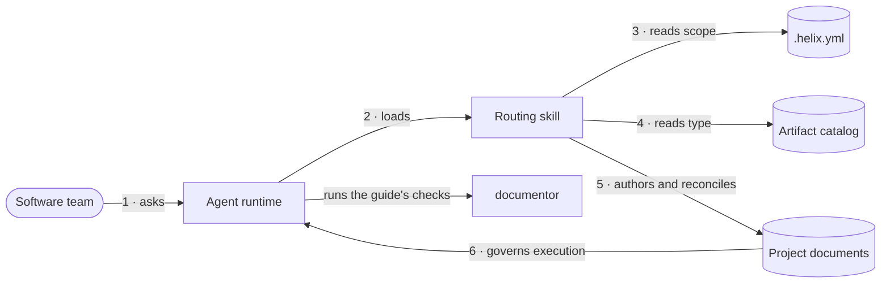

<!-- helix:publish audience=developer page=index kind=explanation voice=onboarding budget=800 written=agent-opus reviewed=2026-10-20/agent-sonnet/123dad4f006487cd -->
<!-- helix:source docs/helix/00-discover/product-vision.md#mission-statement sha256:8905eb9dd1ca94ff -->
<!-- helix:source docs/helix/02-design/architecture.md#level-1-system-context sha256:20eaaf2abca95251 -->
<!-- helix:source docs/helix/02-design/architecture.md#level-2-container-diagram sha256:4d37f71ee8b0bb90 -->
<!-- helix:source docs/helix/02-design/architecture.md#scripts-runtime-behavior-and-specifications sha256:536d2d6c7ff70cf8 -->
<!-- helix:source docs/guide/architecture-views/architecture.md#context sha256:51eb579a579c67b8 -->
<!-- helix:source docs/install/README.md#claude-code sha256:7814218be9564b78 -->
<!-- helix:source justfile sha256:d3e5861049a16f1f -->
<!-- helix:source tools/documentor/README.md sha256:8aa48696dc5b55b3 -->
# Overview

## What it is

HELIX is a methodology and artifact catalog for AI-assisted software teams. It ships portable content and a single routing skill. The skill keeps a project's governing documents, such as PRDs, designs, and test plans, consistent as the work changes.

HELIX has no CLI, tracker, queue, or execution loop. Those belong to a runtime, such as DDx, Claude Code, or Databricks Genie.

A team never runs a HELIX command. They ask their agent runtime, and the runtime loads the HELIX skill. [CONTRACT-003](../../helix/02-design/contracts/CONTRACT-003-ddx-adapter-boundary.md) sets the boundary between HELIX content and a runtime.

## The parts

The repository has nine parts, and the table shows which one a change belongs in. The first five are the portable content that every runtime receives. The other four support, package, or publish that content.

| Part | Path | Change it when |
|------|------|----------------|
| Routing skill | `skills/helix/SKILL.md` | A workflow mode routes, resolves scope, or dispatches differently |
| Mode contracts | `workflows/modes/` | One mode, such as `align` or `design`, needs new behaviour |
| Artifact catalog | `workflows/activities/` | An artifact type's template, prompt, `meta.yml`, or example changes |
| Instance schema | `workflows/artifact-schema.md` | The `meta.yml` or `ddx:` frontmatter contract changes |
| Methodology spec | `workflows/` (non-activity files) | Principles, concerns, conventions, or ratchets change |
| documentor | `tools/documentor/` | The guide's checks, generated views, or site assembly change |
| Dogfood artifacts | `docs/helix/` | HELIX's own vision, PRD, architecture, or ADRs change |
| Per-runtime packaging | `docs/install/`, `scripts/` | Install paths or bundle layout for DDx, Claude Code, or Genie change |
| Microsite | `docs/website/content/`, `website/` | Site prose or Hugo machinery changes |

Three boundaries decide most placements:

- The skill body contains no runtime-specific commands. Runtime detail goes under `docs/install/`: `docs/install/ddx.md`, `docs/install/databricks-genie.md`, and the Claude Code section of `docs/install/README.md`.
- The skill reads the catalog when a mode needs a template or rule; it does not bundle catalog content. A new artifact type is a catalog change, not a skill change.
- Repository scripts are helpers for maintaining and packaging content. They do not define methodology behaviour, so a behaviour change belongs in `workflows/` or the skill.

The `.helix.yml` marker at the repository root declares the active flows and the root each flow may write under.

## One request

A request travels from a person, through the runtime, into the skill, and out as updated documents. The generated context view numbers the steps:



1. **Asks.** A person asks the agent for work in their own words.
2. **Loads.** The runtime loads the HELIX skill as a plug-in.
3. **Reads scope.** The marker says which flows are active and where each may write.
4. **Reads type.** The artifact type's template, prompt, and rules guide the work.
5. **Authors and reconciles.** The mode writes or aligns the governing documents.
6. **Governs execution.** Code implements the documented intent and cannot silently redefine it.

The skill never writes to a tracker, queue, or evidence store. When a mode produces follow-up work, the runtime turns it into tracker items.

<details>
<summary>Containers in the architecture's Level 2 view</summary>

The architecture groups the parts into containers by deployment, not by where a change goes. Mode contracts and the methodology spec sit inside the catalog source and ship with it. documentor and the microsite support the repository and are not deployed containers.

| Container | Responsibility |
|-----------|----------------|
| `skills/helix/SKILL.md` | Is the single agent-facing surface for all workflow modes |
| `workflows/activities/` | Defines artifact types: template, prompt, `meta.yml`, example |
| `workflows/artifact-schema.md` | States the normative schema for `meta.yml` and `ddx:` frontmatter |
| `docs/helix/` | Holds project artifact instances authored from catalog templates |
| Per-runtime packages | Wrap the same source for DDx, Claude Code, and Genie |
| Runtime execution engine | Owns tracker, queue, loop, and evidence, outside the HELIX boundary |

The source in `workflows/` and `skills/helix/` is never forked across packages. Source: `docs/helix/02-design/architecture.md`, Level 2.

</details>

## Where to go next

Read [Architecture](architecture.md) for the system and deployment views, then the [Developer guide](developer-guide.md) for setup and day-to-day tasks.

Before you change a part, run its checks. The `justfile` at the root wraps them:

```sh
just test                     # the main suite, including test-skills
just test-skills              # skill packaging behaviour (tests/validate-skills.sh)
just test-documentor          # documentor's own suite, run inside tools/documentor
just test-website-generated   # generated website checks (tests/validate-website-generated.sh)
```

Each recipe exits with status 0 when its checks pass. `just test` does not run `test-documentor` or `test-website-generated`, so run those separately when you change documentor or the site.

For background beyond the code, read these sources:

- `docs/helix/00-discover/product-vision.md` and `docs/helix/01-frame/prd.md` for the target shape.
- `docs/helix/02-design/architecture.md` for the vocabulary contract, the marker schema, and packaging.
- `workflows/principles.md` and `workflows/ratchets.md` for methodology invariants. Check the current file before relying on either, because both change often.
- `tools/documentor/README.md` for the guide tool's commands.
