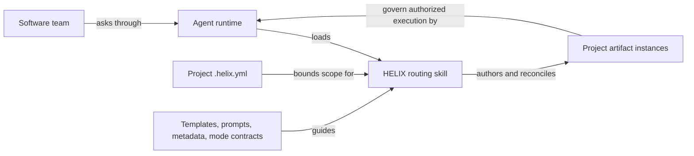

## Purpose

Explain the overall solution to a new developer before they read detailed designs.

## Example

<details open>
<summary>Show a worked example of this artifact</summary>

``````markdown
---
ddx:
  id: helix.solution-overview
  type: solution-overview
  status: draft
  authoring:
    home: repo
---
# HELIX solution overview

## Purpose and audience

HELIX gives software teams and their agents a shared set of documents and
rules for keeping product intent, designs, tests, and implementation aligned.
Start here to understand the system; use the [developer guide](https://github.com/DocumentDrivenDX/helix/blob/main/docs/helix/04-build/developer-guide.md)
to make a change. This is an explanatory view of the current repository.
[Architecture](https://github.com/DocumentDrivenDX/helix/blob/main/docs/helix/02-design/architecture.md) governs system structure; the
[product requirements](https://github.com/DocumentDrivenDX/helix/blob/main/docs/helix/01-frame/prd.md) govern product scope.

## System map

The self-hosted HELIX pilot includes a presentation rendering with the same
entities and arrow directions as this semantic view:


[Editable SVG](https://github.com/DocumentDrivenDX/helix/blob/main/docs/helix/02-design/diagrams/solution-overview.svg) ·
[Design and visual review](https://github.com/DocumentDrivenDX/helix/blob/main/docs/helix/02-design/diagrams/solution-overview-design.md)

The shaded region identifies HELIX-owned content. Dashed arrows show guidance
or constraints; solid arrows show actions or information. The catalog summarizes
templates, prompts, metadata, and mode contracts. Repository paths and omitted
packaging/validation mechanics remain in the adjacent reference material.

Question: how does a team's request become a project document?
Arrows describe information or actions; boxes are content or actors, not running services.



The runtime provides model access, file operations, execution, and source
control. HELIX supplies portable Markdown and YAML content plus one routing
skill. A request to plan does not authorize implementation.

## Parts and boundaries

| Part | Responsibility | Where to inspect |
|---|---|---|
| Routing skill | Resolve project scope, catalog, and workflow mode | `skills/helix/SKILL.md` |
| Methodology | Authority order, authoring rules, mode behavior | `workflows/modes/`, `workflows/artifact-schema.md` |
| Artifact catalog | Define each document type through template, prompt, metadata, example | `workflows/activities/*/artifacts/` |
| Type graph | Describe catalog relationships; generated from metadata | `workflows/graph.yml`, `scripts/generate_graph.py` |
| Project documents | Apply HELIX to HELIX itself | `docs/helix/` |
| Delivery tooling | Validate, package, and publish source content | `tests/`, `scripts/`, `docs/website/`, `website/` |

The project marker declares active document roots. Catalog definitions under
`workflows/` are maintained by contributors; ordinary adopting-project authoring
writes instances under the marker's root. Runtime integration is governed by
[CONTRACT-003](https://github.com/DocumentDrivenDX/helix/blob/main/docs/helix/02-design/contracts/CONTRACT-003-ddx-adapter-boundary.md).

## Critical flows

- **Author a document:** resolve marker and catalog, choose a mode, read governing
  artifacts and type instructions, write within scope, validate, review.
  Follow the [end-to-end walkthrough](https://github.com/DocumentDrivenDX/helix/blob/main/docs/helix/02-design/architecture-walkthrough.md).
- **Change the methodology:** edit canonical content, regenerate derived graph
  and reference pages as applicable, run repository gates, review the diff.
  Follow the developer guide's change recipes.
- **Deliver to a runtime:** package the same skill and catalog with generated
  references. `tests/validate-plugin-package.sh` checks source/package agreement.
  Installation instructions live in [docs/install](https://github.com/DocumentDrivenDX/helix/blob/main/docs/install/README.md).

## Vocabulary and reading path

An **artifact type** is a reusable document definition; an **instance** is a
project's document made from it. A **flow** applies a methodology to a marker's
bounded root. A **mode** is a workflow inside the single public `helix` skill.
A **concern** supplies cross-cutting practices such as module boundaries.

Read this overview → architecture walkthrough → developer guide for a first
contribution. Consult Architecture for structural decisions, the catalog for
document contracts, and [installation guidance](https://github.com/DocumentDrivenDX/helix/blob/main/docs/install/README.md) for host setup.

## Maintenance

Contributors update this map when routing, packaging, catalog ownership, or
artifact boundaries change. Review it alongside Architecture. Check every
linked path and trace the critical flow after such changes; generated graph
and reference pages remain derived outputs. This pilot has repository evidence,
but has not yet been tested by an unfamiliar developer.
``````

</details>

## Reference

<table class="helix-reference-table">
<tbody>
<tr><th>Activity</th><td><a href="../../../reference/glossary/activities/"><strong>Design</strong></a> — Decide how to build it. Capture trade-offs, contracts, and architecture decisions.</td></tr>
<tr><th>Default location</th><td><code>docs/helix/02-design/solution-overview.md</code></td></tr>
<tr><th>Requires</th><td><em>None</em></td></tr>
<tr><th>Enables</th><td><em>None</em></td></tr>
<tr><th>Informs</th><td><a href="../../../artifact-types/build/developer-guide/">Developer Guide</a></td></tr>
<tr><th>Generation prompt</th><td><details><summary>Show the full generation prompt</summary><pre><code># Solution Overview authoring prompt&#10;&#10;Explain the overall solution to a new developer before they read detailed designs.&#10;This is a navigational projection of governing artifacts, not a new source of&#10;requirements or structural decisions. Link to Architecture, requirements,&#10;and relevant contracts. Identify current versus proposed views and uncertainty.&#10;Use one readable system map with labeled arrows, boundaries, and a legend.&#10;For content libraries or batch tools, draw actual content and execution actors;&#10;do not invent services to fill a conventional architecture diagram.&#10;Name concrete source locations and two or three critical flows. Link to a&#10;walkthrough and developer guide. Define unfamiliar vocabulary locally.&#10;Keep setup commands in the developer guide and structural decisions in Architecture.&#10;Name update triggers and the maintainer role. Check every source link.&#10;&#10;## Presentation visual quality&#10;&#10;For conference or flagship visuals, apply `workflows/references/diagram-design.md`.&#10;Start with the audience, one question, one takeaway, and semantic entities/edges.&#10;Keep a maintainable semantic view and create an editable vector presentation&#10;view when precise composition is needed. Use a named boundary, deliberate&#10;hierarchy, readable labels, and consistent color/connector roles. Retain source&#10;paths in adjacent prose. Render and inspect at full and preview sizes; correct&#10;collisions before delivery. Record export provenance, semantic parity, deliberate&#10;omissions, review evidence, and limits. Do not equate a successful export with&#10;readability or an unperformed audience trial. This is an optional delivery&#10;profile, not a new requirement for every reference diagram.&#10;&#10;For a developer-facing HTML field guide, use the architecture field guide profile&#10;and reusable prompt in `workflows/references/diagram-design.md`. Start with&#10;`workflows/references/architecture-plate.html`; replace all worked-example facts.&#10;Keep the numbered walkthrough, sources, limits, offline delivery, mobile and&#10;print review. Reference HTML supplies styling ideas, never project authority.</code></pre></details></td></tr>
<tr><th>Template</th><td><details><summary>Show the template structure</summary><pre><code>---&#10;ddx:&#10;  id: solution-overview&#10;  authoring:&#10;    home: repo&#10;---&#10;&#10;# Solution Overview&#10;&#10;## Purpose and audience&#10;&#10;[System purpose, reader task, current/proposed state, and governing artifact links.]&#10;&#10;## System map&#10;&#10;[Question, audience, intended takeaway, current/proposed state, and legend:&#10;actors, boundaries, and labeled information/action arrows.]&#10;&#10;[For a presentation version, follow `workflows/references/diagram-design.md`.&#10;Embed the rendered diagram and link editable vector source, export/rebuild&#10;instructions, and visual-review evidence. Keep the semantic source below;&#10;record simplifications and review both views for matching meaning.]&#10;&#10;```mermaid&#10;flowchart LR&#10;    Actor[User or agent] --&gt;|requests action from| System[System]&#10;```&#10;&#10;[Optional developer HTML: link an offline architecture field guide using the&#10;`diagram-design.md` HTML profile and `architecture-plate.html` scaffold. Include&#10;numbered flow notes, governing sources, omissions, and rendered review evidence.]&#10;&#10;## Parts and boundaries&#10;&#10;| Part | Responsibility | Source / authority |&#10;|---|---|---|&#10;| [Part] | [Owned behavior] | [Concrete path or link] |&#10;&#10;## Critical flows&#10;&#10;[Two or three representative actions. Link one end-to-end architecture walkthrough and its proving tests; distinguish test intent from observed execution.]&#10;&#10;## Vocabulary and reading path&#10;&#10;[Define unfamiliar terms; order links from overview to walkthrough, developer guide, and deeper references.]&#10;&#10;## Maintenance&#10;&#10;[Maintainer role, changes that trigger updates, source/link checks, and uncertainty.]</code></pre></details></td></tr>
</tbody>
</table>
