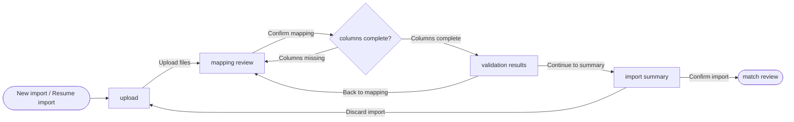

## Purpose

User Flow is the **feature-level flow artifact**. Its unique job is to record
the views (screens, modals, panels, voice or chat turns), the actions that
connect them, the decision points, the entry and exit points and every
alternate path, with the feedback the person sees on each transition.

HELIX retired `ux-design` as a monolithic artifact. User Flow does not revive
it: it carries only the flow, in a shape a tool can generate and check. The
solution design links `UF-XXX` instead of restating views and transitions, and
the rationale for choosing this flow over another stays in the solution design.

## Example

<details open>
<summary>Show a worked example of this artifact</summary>

``````markdown
---
ddx:
  id: example.user-flow.depositmatch.csv-import
  authoring:
    home: repo
  depends_on:
    - example.feature-specification.depositmatch.csv-import
    - example.user-story.depositmatch.upload-csv
---

# UF-001: CSV Import User Flow

**Feature**: [[FEAT-001]] CSV Import and Column Mapping | **Solution design**: [[SD-001]] | **Journey maps**: [[UJM-001]]

## Scope

- **Covers**: Upload, mapping review, validation results and the import summary for one client's import session.
- **Entry points**: "New import" on a client's reconciliation workspace; "Resume import" on a draft session.
- **Exits**: Match review (FEAT-002) after the summary is confirmed; back to the client workspace.
- **Size classes**: compact, expanded. On compact, validation results show one rejected row per card instead of a table.
- **Out of scope**: Match review (UF-002).

## Views

| View | Kind | Purpose | Stories | Wireframe |
|---|---|---|---|---|
| upload | screen | Attach this week's bank and invoice CSV files | US-001 | [[UF-001-01-upload]] |
| mapping review | screen | Confirm or adjust which columns hold amount, date and identifier | US-002 | [[UF-001-02-mapping-review]] |
| columns complete? | decision | Check every required column is mapped | US-002 | none |
| validation results | screen | See which rows were rejected and why | US-003 | [[UF-001-03-validation-results]] |
| import summary | screen | Confirm what will be imported before matching starts | US-003 | [[UF-001-04-import-summary]] |
| match review | external | FEAT-002 takes over | none | none |

## Flow Diagram



## Transitions

| Action | From | Control | Guard | To | Feedback | Changed region |
|---|---|---|---|---|---|---|
| Upload files | upload | "Upload" button | both files are CSV | mapping review | Progress per file; a non-CSV file is rejected inline before parsing | full view |
| Confirm mapping | mapping review | "Confirm mapping" button | none | columns complete? | Button busy; second click blocked | action bar |
| Columns missing | columns complete? | none (system) | a required column is unmapped | mapping review | Inline error names each missing column; chosen mappings kept | mapping table |
| Columns complete | columns complete? | none (system) | every required column is mapped | validation results | Validation progress, then the rejected-row count | full view |
| Back to mapping | validation results | "Back to mapping" link | none | mapping review | Mappings shown as last confirmed | full view |
| Continue to summary | validation results | "Continue" button | none | import summary | Summary counts | full view |
| Discard import | import summary | "Discard import" button | none | upload | Toast "Import discarded" with Undo for 10 s | full view |
| Confirm import | import summary | "Confirm import" button | not already confirmed | match review | Button busy; toast "Import confirmed"; match suggestions start | full view |

## Alternate Paths

| Path | Trigger | Transitions | Recovery |
|---|---|---|---|
| Error | A required column is not mapped | Confirm mapping → Columns missing | Map the column and confirm again; other mappings kept |
| Error | Confirming the import fails to save | Confirm import | Inline error with "Try again"; nothing is imported until it succeeds |
| Cancel | The reviewer abandons the import | Discard import | Undo in the toast restores the draft session |
| Empty | Every row is rejected | Columns complete → validation results | "Continue" is disabled with the reason; "Back to mapping" stays available |
| Permission denied | Cannot occur: anyone who can open a client's workspace can import for it | none | none |

## Story Traceability

| Journey | Task | Stories / ACs | Path |
|---|---|---|---|
| import weekly files | Import a client's weekly files | US-001-AC1, US-002-AC1, US-003-AC1 | Upload files → Confirm mapping → Columns complete → Continue to summary → Confirm import |
| import weekly files, wrong file type | Import a client's weekly files | US-001-AC2 | Upload files rejected; stays on upload |
| import weekly files, missing column | Import a client's weekly files | US-002-AC2 | Upload files → Confirm mapping → Columns missing → Confirm mapping |

## Dead Ends

- None. Match review is FEAT-002's flow (UF-002).
``````

</details>

## Reference

<table class="helix-reference-table">
<tbody>
<tr><th>Activity</th><td><a href="../../../reference/glossary/activities/"><strong>Design</strong></a> — Decide how to build it. Capture trade-offs, contracts, and architecture decisions.</td></tr>
<tr><th>Default location</th><td><code>docs/helix/02-design/flows/UF-{n}-{feature}/UF-{n}.md</code></td></tr>
<tr><th>Requires</th><td><em>None</em></td></tr>
<tr><th>Enables</th><td><em>None</em></td></tr>
<tr><th>Informs</th><td><a href="../../../artifact-types/design/wireframe/">Wireframe</a><br><a href="../../../artifact-types/design/solution-design/">Solution Design</a><br><a href="../../../artifact-types/test/story-test-plan/">Story Test Plan</a></td></tr>
<tr><th>Generation prompt</th><td><details><summary>Show the full generation prompt</summary><pre><code># User Flow Generation Prompt&#10;&#10;Describe how people move through one feature&#x27;s views: what each action does,&#10;what they see while it happens, and every way it can go wrong.&#10;&#10;## Purpose&#10;&#10;User Flow is the **feature-level flow artifact**. Its unique job is to record&#10;the views (screens, modals, panels, voice or chat turns), the actions that&#10;connect them, the decision points, the entry and exit points and every&#10;alternate path, with the feedback the person sees on each transition.&#10;&#10;HELIX retired `ux-design` as a monolithic artifact. User Flow does not revive&#10;it: it carries only the flow, in a shape a tool can generate and check. The&#10;solution design links `UF-XXX` instead of restating views and transitions, and&#10;the rationale for choosing this flow over another stays in the solution design.&#10;&#10;## Focus&#10;&#10;- Create `docs/helix/02-design/flows/UF-XXX-[feature]/UF-XXX.md`, numbered&#10;  after the governing feature. The feature&#x27;s wireframes go in the same folder.&#10;- List every view once, named by what it is. A modal or panel is its own view.&#10;  A state of a view (loading, empty, error) is not a view; its wireframe&#x27;s&#10;  States and Events section holds it.&#10;- Name each transition by its action. For each, give the control that triggers&#10;  it, any guard, the target view, the feedback and the changed region. Do not&#10;  number rows; paths and links use the action names.&#10;- Name a decision view for every branch the person or the system takes.&#10;- Give every action that can fail, be cancelled, return nothing or be denied&#10;  its alternate path. If one cannot occur, say why.&#10;- Keep the Mermaid diagram and the Transitions table identical in content.&#10;- Trace every journey to a path of named transitions and the `US-&lt;n&gt;-AC&lt;m&gt;`&#10;  IDs it proves. Name the Task Model row the journey carries out.&#10;- Do not specify layout (the wireframe owns it) or visual values (DESIGN.md&#10;  owns them).&#10;&#10;## Boundary Test&#10;&#10;| If you are writing... | Put it in... |&#10;|---|---|&#10;| Views, actions, controls, guards, feedback, alternate paths | User Flow |&#10;| Why this flow was chosen over another; component decomposition | Solution Design |&#10;| Exact route, API or event surface behind a transition | Contract |&#10;| Layout, states and events of one view | Wireframe |&#10;| One person&#x27;s experience across several stories | User Journey Map |&#10;| Which test walks which path | Story Test Plan |&#10;&#10;## Completion Criteria&#10;&#10;- Entry and exit points named; every view reachable.&#10;- Every transition names its action, control, feedback and target.&#10;- Every action that can fail, be cancelled or return nothing has an alternate&#10;  path.&#10;- Diagram and table agree.&#10;- Every journey traced to named transitions and acceptance criteria.</code></pre></details></td></tr>
<tr><th>Template</th><td><details><summary>Show the template structure</summary><pre><code>---&#10;ddx:&#10;  id: UF-XXX&#10;  authoring:&#10;    home: repo&#10;  depends_on:&#10;    - FEAT-XXX&#10;    - US-XXX&#10;---&#10;&#10;# UF-XXX: [Feature Name] User Flow&#10;&#10;**Feature**: [[FEAT-XXX]] | **Solution design**: [[SD-XXX]] | **Journey maps**: [[UJM-XXX]] or none&#10;&#10;## Scope&#10;&#10;- **Covers**: [The views this feature owns]&#10;- **Entry points**: [Where people arrive from: a navigation destination, a deep link, a notification]&#10;- **Exits**: [Where the flow hands off: another feature, an external system, sign-out]&#10;- **Size classes**: [compact, medium, expanded] [Note where the flow differs by size class]&#10;- **Out of scope**: [Adjacent flows owned elsewhere, by UF ID]&#10;&#10;## Views&#10;&#10;&lt;!-- Kind: screen | modal | panel | turn (voice or chat) | external | decision.&#10;One row per view, named by what it is. Each view other than external and&#10;decision gets a wireframe, UF-XXX-NN-view, in this folder. --&gt;&#10;&#10;| View | Kind | Purpose | Stories | Wireframe |&#10;|---|---|---|---|---|&#10;| [view name] | screen | [The one task this view serves] | [US-XXX] | [[UF-XXX-01-view-name]] |&#10;&#10;## Flow Diagram&#10;&#10;&lt;!-- Views and transitions match the tables. Label each edge with its action.&#10;Use a diamond for decisions and a stadium for entry and exit. --&gt;&#10;&#10;```mermaid&#10;flowchart LR&#10;  start([Entry]) --&gt; a[View A]&#10;  a -- &quot;Action&quot; --&gt; b[View B]&#10;  b -- &quot;Action&quot; --&gt; d{Decision}&#10;  d -- &quot;yes&quot; --&gt; c[View C]&#10;  d -- &quot;no&quot; --&gt; a&#10;```&#10;&#10;## Transitions&#10;&#10;&lt;!-- One row per transition, named by its action. Control: what the person&#10;activates. Guard: the condition, or none. Feedback: what the person sees during&#10;and after. Changed region: full view, or the part that changes. --&gt;&#10;&#10;| Action | From | Control | Guard | To | Feedback | Changed region |&#10;|---|---|---|---|---|---|---|&#10;| [Action] | [view] | [control] | [condition or none] | [view] | [progress / success / error / undo] | [full view or region] |&#10;&#10;## Alternate Paths&#10;&#10;&lt;!-- Every action that can fail, be cancelled, return nothing or be denied.&#10;Name the transitions the path uses, or say why it cannot occur. --&gt;&#10;&#10;| Path | Trigger | Transitions | Recovery |&#10;|---|---|---|---|&#10;| Error | [What fails] | [Action → Action] | [How the person recovers; is their input kept?] |&#10;| Cancel | | | |&#10;| Empty | | | |&#10;| Permission denied | | | |&#10;&#10;## Story Traceability&#10;&#10;&lt;!-- Journey: the journey&#x27;s name. Task: the feature specification&#x27;s Task Model&#10;row it carries out. Path: the named transitions in order. --&gt;&#10;&#10;| Journey | Task | Stories / ACs | Path |&#10;|---|---|---|---|&#10;| [journey name] | [task name] | [US-XXX-AC1, US-XXX-AC2] | [Action → Action → view] |&#10;&#10;## Dead Ends&#10;&#10;- [A view with no exit, an unreachable view or an unresolved branch, or &quot;None&quot;]</code></pre></details></td></tr>
</tbody>
</table>
