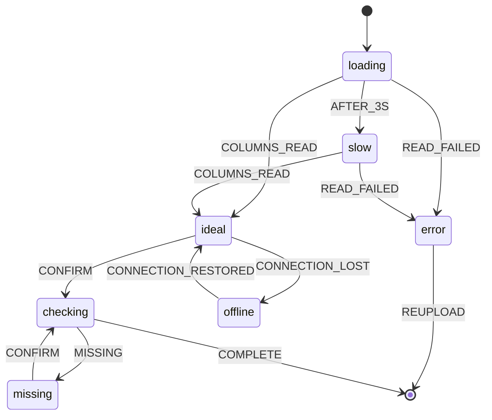

## Purpose

Wireframe is the **view-level layout and state artifact**. Its unique job is
to record what is in one view, where, what each element does, and which states
the view moves through, so builders and reviewers share one picture. States
left implicit are the states that ship broken, so the wireframe names them
all. The solution or technical design links the wireframe by ID.

## Example

<details open>
<summary>Show a worked example of this artifact</summary>

``````markdown
---
ddx:
  id: example.wireframe.depositmatch.mapping-review
  type: wireframe
  authoring:
    home: repo
  depends_on:
    - example.user-flow.depositmatch.csv-import
---

# UF-001-02-mapping-review: Mapping Review

**User flow**: [[UF-001]] view `mapping review` | **Stories**: [[US-002]]

## Scope and Fidelity

- **View**: Confirm which columns hold amount, date and identifier in each file before rows are validated.
- **Modality**: screen
- **Fidelity**: mid
- **Size classes**: compact, expanded
- **Pattern**: Form with a mapping table

## Layouts

### Expanded

```text
┌─────────────────────────────────────────────────────────────┐
│ [Back to client]   Acme Dental · Import 2026-05-08          │
├──────────────────────────────┬──────────────────────────────┤
│ [Bank file mapping]          │ [Invoice file mapping]       │
│  Amount  → [column picker]   │  Amount  → [column picker]   │
│  Date    → [column picker]   │  Date    → [column picker]   │
│  ID      → [column picker]   │  ID      → [column picker]   │
│ [Sample rows]                │ [Sample rows]                │
├──────────────────────────────┴──────────────────────────────┤
│ [Saved mapping note]                      [Confirm mapping] │
└─────────────────────────────────────────────────────────────┘
```

### Compact

```text
┌──────────────────────────┐
│ [Back to client]         │
│ [File tabs: Bank|Invoice]│
│ [Bank file mapping]      │
│  Amount → [column picker]│
│  Date   → [column picker]│
│  ID     → [column picker]│
│ [Sample rows]            │
├──────────────────────────┤
│ [Confirm mapping]        │
└──────────────────────────┘
```

### Annotations

| Element | Kind | Annotation | Size classes | Links |
|---|---|---|---|---|
| Back to client | control | Returns to the client workspace; the draft session is kept. | all | none |
| File tabs | control | Switches between the bank and invoice mappings. | compact | none |
| Bank file mapping | region | One column picker per required field, preselected from the saved mapping when there is one. | all | US-002-AC1 |
| Invoice file mapping | region | As for the bank file. Beside it on expanded; behind the tab on compact. | differs | US-002-AC1 |
| Column picker | control | Lists the file's column headers. A required field left empty is flagged when the mapping is confirmed. | all | US-002-AC2 |
| Sample rows | content | The first five rows under the chosen columns, so a wrong pick is visible before import. | all | none |
| Saved mapping note | content | "Using the mapping saved on 2026-05-01. Changes are saved when you confirm." | expanded | US-002-AC1 |
| Confirm mapping | control | Checks the required fields and starts validation. Busy while checking; blocks a second click. | all | UF-001 Confirm mapping |

## States and Events

### States

| State | Applies | Entered when | Person sees | Available actions | Announcement | Exit |
|---|---|---|---|---|---|---|
| ideal | yes | Columns read from both files | Pickers, sample rows | Pick columns, Confirm mapping, Back to client | none; focus on the heading | CONFIRM |
| empty | no: both files are already attached when this view opens | | | | | |
| loading | yes | View opens | Skeleton pickers | Back to client | none; focus on the heading "Loading columns" | COLUMNS_READ, READ_FAILED |
| partial | no: both files' columns are read together | | | | | |
| error | yes | A file's columns cannot be read | "We couldn't read the invoice file's columns" and the reason | Upload again, Back to client | "Couldn't read the file's columns" (assertive) | REUPLOAD |
| offline | yes | Connection lost | Banner "You're offline; mappings are kept"; Confirm mapping disabled | Pick columns, Back to client | "You're offline" (polite) | CONNECTION_RESTORED |
| slow | yes | Loading takes longer than 3 s | Skeleton and "Still reading columns" | Back to client | "Still reading the files" (polite) | COLUMNS_READ, READ_FAILED |
| permission-denied | no: anyone who can open the workspace can import | | | | | |
| success | no: a confirmed mapping moves straight to validation results | | | | | |
| checking | yes | Confirm mapping pressed | Confirm mapping busy | none; checking takes under a second | "Checking the mapping" (polite) | COMPLETE, MISSING |
| missing | yes | A required field is unmapped | Inline error naming each missing field; picks kept | Pick columns, Confirm mapping | "Amount is not mapped in the invoice file" (assertive) | CONFIRM |

### Statechart



### Events

| Event | From | Guard | To | Effect |
|---|---|---|---|---|
| AFTER_3S | loading | none | slow | Show "Still reading columns" |
| COLUMNS_READ | loading, slow | none | ideal | Preselect the saved mapping |
| READ_FAILED | loading, slow | none | error | Focus moves to the error message |
| REUPLOAD | error | none | final | User flow returns to upload |
| CONFIRM | ideal, missing | none | checking | Check required fields |
| MISSING | checking | a required field is unmapped | missing | Focus moves to the first missing picker; picks kept |
| COMPLETE | checking | every required field is mapped | final | Save the mapping; user flow goes to validation results |
| CONNECTION_LOST | ideal | none | offline | Disable Confirm mapping |
| CONNECTION_RESTORED | offline | none | ideal | Enable Confirm mapping |

## Accessibility

- **Focus order**: Back to client, File tabs (compact), each column picker in the bank file then the invoice file, Confirm mapping.
- **Accessible names**: each picker is named by field and file ("Invoice file: amount column").
- **Headings and landmarks**: h1 "Map columns for Acme Dental"; each file's mapping is a labelled region.
- **Target size and input**: pickers and Confirm mapping at least 44 × 44 px on coarse input.

## Open Questions

- Should the saved mapping note appear on compact? Product decides; it is hidden there today to keep the pickers above the fold.
``````

</details>

## Reference

<table class="helix-reference-table">
<tbody>
<tr><th>Activity</th><td><a href="../../../reference/glossary/activities/"><strong>Design</strong></a> — Decide how to build it. Capture trade-offs, contracts, and architecture decisions.</td></tr>
<tr><th>Default location</th><td><code>docs/helix/02-design/flows/UF-{n}-{feature}/UF-{n}-{nn}-{view}.md</code></td></tr>
<tr><th>Requires</th><td><em>None</em></td></tr>
<tr><th>Enables</th><td><em>None</em></td></tr>
<tr><th>Informs</th><td><a href="../../../artifact-types/design/technical-design/">Technical Design</a><br><a href="../../../artifact-types/test/story-test-plan/">Story Test Plan</a></td></tr>
<tr><th>Generation prompt</th><td><details><summary>Show the full generation prompt</summary><pre><code># Wireframe Generation Prompt&#10;&#10;Lay out one view of a user flow at each size class it supports, annotate every&#10;element a person can act on, and name every state the view can be in.&#10;&#10;## Purpose&#10;&#10;Wireframe is the **view-level layout and state artifact**. Its unique job is&#10;to record what is in one view, where, what each element does, and which states&#10;the view moves through, so builders and reviewers share one picture. States&#10;left implicit are the states that ship broken, so the wireframe names them&#10;all. The solution or technical design links the wireframe by ID.&#10;&#10;## Focus&#10;&#10;- Create `docs/helix/02-design/flows/UF-XXX-[feature]/UF-XXX-NN-[view].md`&#10;  beside its user flow. NN is a two-digit number given once, when the&#10;  wireframe is created: the next number not yet used in that folder. Keep it&#10;  when views are added, removed or reordered; never renumber an existing&#10;  wireframe, and do not reuse a retired number. Put images in the folder&#x27;s&#10;  `assets/`. Set `ddx.type: wireframe`.&#10;- Take the view&#x27;s name, actions and transitions from the user flow.&#10;- State the modality (screen, voice or chat) and the fidelity first, and&#10;  annotate to the fidelity&#x27;s depth:&#10;  - **sketch**: the idea each region serves;&#10;  - **low**: layout decisions: regions, order, what is primary;&#10;  - **mid**: functionality: what each control does, validation, destination;&#10;  - **high**: interaction, exact content, every state, accessibility.&#10;- Draw one layout per supported size class. For voice or chat, the layout is&#10;  the turn: what the system says, what the person can say or choose, and the&#10;  confirmation.&#10;- Label elements on the drawing by name and keep the words in the Annotations&#10;  table. Give every interactive element a row that names the transition it&#10;  triggers. Do not number rows.&#10;- Fill the States table first. Each of ideal, empty, loading, partial, error,&#10;  offline, slow, permission-denied and success either applies or is excluded&#10;  with a concrete reason. Add view-specific states such as saving or&#10;  streaming.&#10;- For every state, give what the person sees, the available actions, the&#10;  announcement (text and politeness, or the focus move that carries it) and the&#10;  events that leave it. Say whether an error keeps what the person entered.&#10;- Draw a Mermaid `stateDiagram-v2`, and keep it, the States table and the&#10;  Events table in agreement.&#10;- Note focus order, accessible names, headings and landmarks, and target size.&#10;- Reference DESIGN.md tokens; do not define colors, type or spacing.&#10;&#10;## Boundary Test&#10;&#10;| If you are writing... | Put it in... |&#10;|---|---|&#10;| Layout, element purpose, states, events, announcements of one view | Wireframe |&#10;| Movement between views | User Flow |&#10;| The app-wide convention for how a loading or error state looks | DESIGN.md |&#10;| Exact error codes or payloads that trigger a state | Contract |&#10;| Component props, files, state management | Technical Design |&#10;| Which test drives which state | Story Test Plan |&#10;&#10;## Completion Criteria&#10;&#10;- Modality and fidelity stated; annotation depth matches the fidelity.&#10;- One layout per supported size class.&#10;- Every interactive element annotated and linked to the flow.&#10;- Every standard state applies or is excluded with a reason.&#10;- Every state has an exit, and an announcement where focus does not carry it.&#10;- Statechart and tables agree.&#10;- Accessibility notes present.</code></pre></details></td></tr>
<tr><th>Template</th><td><details><summary>Show the template structure</summary><pre><code>---&#10;ddx:&#10;  id: UF-XXX-NN-view-name&#10;  type: wireframe&#10;  authoring:&#10;    home: repo&#10;  depends_on:&#10;    - UF-XXX&#10;    - US-XXX&#10;---&#10;&#10;# UF-XXX-NN-view-name: [View Name]&#10;&#10;**User flow**: [[UF-XXX]] view `[view name]` | **Stories**: [[US-XXX]]&#10;&#10;## Scope and Fidelity&#10;&#10;- **View**: [What this view is for: its one task]&#10;- **Modality**: [screen | voice | chat]&#10;- **Fidelity**: [sketch | low | mid | high]&#10;- **Size classes**: [compact, medium, expanded]&#10;- **Pattern**: [Design-system or SDK pattern, if one is used]&#10;&#10;&lt;!-- Annotation depth by fidelity:&#10;sketch: the idea each region serves.&#10;low: layout decisions: regions, order, what is primary.&#10;mid: functionality: what each control does, validation, where it goes.&#10;high: interaction, exact content, every state, accessibility. --&gt;&#10;&#10;## Layouts&#10;&#10;&lt;!-- One layout per size class. Label elements on the drawing by name and keep&#10;the words in the Annotations table. Use an image under assets/ or a box&#10;drawing. For voice or chat, the layout is the turn: what the system says, what&#10;the person can say or choose, and the confirmation. --&gt;&#10;&#10;### [Size class]&#10;&#10;```text&#10;┌──────────────────────────────┐&#10;│ [Header]                     │&#10;├──────────────────────────────┤&#10;│ [Main region]                │&#10;│                              │&#10;│ [Primary action]             │&#10;└──────────────────────────────┘&#10;```&#10;&#10;### Annotations&#10;&#10;&lt;!-- One row per element, named as on the drawing. Kind: region | control |&#10;content | feedback. Every interactive element has a row. Links: the user-flow&#10;transition it triggers, an acceptance criterion, or a DESIGN.md token. --&gt;&#10;&#10;| Element | Kind | Annotation | Size classes | Links |&#10;|---|---|---|---|---|&#10;| [Element] | [region / control / content / feedback] | [What it is for or does, at the stated fidelity] | [all, or which] | [transition, US-XXX-ACn, token] |&#10;&#10;## States and Events&#10;&#10;### States&#10;&#10;&lt;!-- Every standard state either applies or is excluded with a concrete&#10;reason. Add view-specific states (saving, streaming, editing) as needed.&#10;Announcement: the text a screen reader hears and its politeness (polite or&#10;assertive), or the focus move that carries the change. --&gt;&#10;&#10;| State | Applies | Entered when | Person sees | Available actions | Announcement | Exit |&#10;|---|---|---|---|---|---|---|&#10;| ideal | yes | [event or condition] | [What is shown] | [Actions, or &quot;none&quot; and why] | [&quot;Text&quot; (polite)] | [Events that leave] |&#10;| empty | [yes / no: reason] | | | | | |&#10;| loading | | | | | | |&#10;| partial | | | | | | |&#10;| error | | | | | | |&#10;| offline | | | | | | |&#10;| slow | | | | | | |&#10;| permission-denied | | | | | | |&#10;| success | | | | | | |&#10;&#10;### Statechart&#10;&#10;```mermaid&#10;stateDiagram-v2&#10;  [*] --&gt; loading&#10;  loading --&gt; ideal: LOADED&#10;  loading --&gt; error: FAILED&#10;  error --&gt; loading: RETRY&#10;```&#10;&#10;### Events&#10;&#10;| Event | From | Guard | To | Effect |&#10;|---|---|---|---|---|&#10;| [EVENT] | [state] | [condition or none] | [state] | [What the system does: request, focus move, input kept] |&#10;&#10;## Accessibility&#10;&#10;- **Focus order**: [Elements in order]&#10;- **Accessible names**: [Icon-only and ambiguous controls with their names]&#10;- **Headings and landmarks**: [View heading, regions]&#10;- **Target size and input**: [Touch targets on coarse input; keyboard shortcuts]&#10;&#10;## Open Questions&#10;&#10;- [A layout, content or state decision still open, and who decides, or &quot;None&quot;]</code></pre></details></td></tr>
</tbody>
</table>
