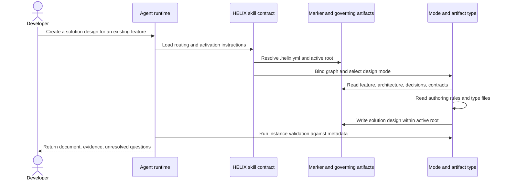

> **Example from HELIX's own docs.** This generated page comes from `docs/helix/`. Use it to see the method in practice; start with the [artifact-type catalog](/artifact-types/) for reusable templates. Historical plans and reports may describe retired architecture.

> **Source identity** (from `02-design/architecture-walkthrough.md`):

```yaml
ddx:
  id: helix.architecture-walkthrough
  status: draft
  authoring:
    home: repo
```

# Architecture walkthrough: authoring a project document

## Scenario and scope

A developer asks their agent to create a solution design for an existing
feature. The observable result is a project document whose scope, governing
references, and sections can be reviewed. This walkthrough explains the current
content contracts; it is not a transcript or proof of a live model session.
[Architecture](/artifacts/architecture/) remains the structural authority.

## Sequence

Question: which inputs constrain the agent before it writes a document?
Participants are a person, a runtime, and repository content. Calls to content
mean file reads or writes performed by the agent through the runtime.



## Steps and evidence

| Step | Source to inspect | State or output | Verification |
|---|---|---|---|
| Resolve scope | `skills/helix/SKILL.md`, Activation Discipline; `.helix.yml` | Authorized flow and root | `tests/validate-plugin-catalog-resolution.sh` checks catalog availability, not live routing |
| Bind catalog | Skill, Catalog Resolution; `workflows/graph.yml` | One catalog source supplies graph and type files | `tests/validate-plugin-package.sh` checks packaged source agreement |
| Choose behavior | `workflows/modes/design.md`, `workflows/modes/_authoring.md` | Design instructions and authority boundary | `tests/validate-actions.sh` checks action registration and shape |
| Gather design context | `workflows/activities/02-design/artifacts/solution-design/prompt.md` and adjacent files | Requirements, alternatives, component decomposition | Human review checks that claims match governing evidence |
| Write instance | Type `meta.yml` output convention and `template.md` | `docs/helix/02-design/solution-designs/SD-…md` with `ddx.id` | `skills/helix/scripts/validate-instance.py` checks supported metadata rules |
| Review result | Type quality checks and governing artifacts | Reviewed design or explicit unresolved gaps | `tests/validate-instance.sh` exercises validator behavior; review establishes semantic fit |

The `ddx:` YAML namespace carries document identity; it does not require a
tracker. The runtime performs file operations and invokes available validation.
The skill and catalog supply instructions, not executable service calls.

## Failure paths

- A malformed marker stops authoring. Multiple unresolved active scopes require
  a scope choice before a write.
- A broken catalog pointer warns and falls through the skill's ordered catalog
  sources. Failure to bind any source stops authoring.
- Missing required authority or contradictory governing artifacts must be
  surfaced; a plausible invented requirement cannot substitute for evidence.
- Validation errors return the document for correction. Passing structural
  checks does not establish design correctness or approval.
- A checked-out externally authored governing artifact is undependable; follow
  its origin and checkout rules before relying on its content.

## Safe change points

To improve the decomposition instructions, edit the Solution Design type's
prompt/template/example together. Change routing only in the public skill and
its mode contracts. Change validation mechanics in the packaged validator and
its tests. Regenerate the graph after changing metadata relationships.
Use the [developer guide](https://github.com/DocumentDrivenDX/helix/blob/main/docs/guide/developer/developer-guide.md) for commands and gates.

## Maintenance

Review this walkthrough when activation, catalog binding, design mode, instance
validation, or authoring-home rules change. Trace every row to its named source.
A future unfamiliar-developer session should check whether readers can locate
the write surface and explain a failure path without assistance.
