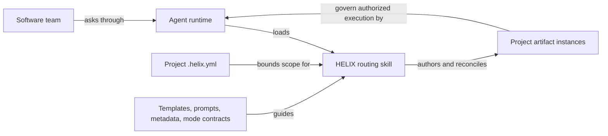

> **Example from HELIX's own docs.** This generated page comes from `docs/helix/`. Use it to see the method in practice; start with the [artifact-type catalog](/artifact-types/) for reusable templates. Historical plans and reports may describe retired architecture.

> **Source identity** (from `02-design/solution-overview.md`):

```yaml
ddx:
  id: helix.solution-overview
  type: solution-overview
  status: draft
  authoring:
    home: repo
```

# HELIX solution overview

## Purpose and audience

HELIX gives software teams and their agents a shared set of documents and
rules for keeping product intent, designs, tests, and implementation aligned.
Start here to understand the system; use the [developer guide](https://github.com/DocumentDrivenDX/helix/blob/main/docs/guide/developer/developer-guide.md)
to make a change. This is an explanatory view of the current repository.
[Architecture](/artifacts/architecture/) governs system structure; the
[product requirements](/artifacts/prd/) govern product scope.

## System map


[Editable architecture field guide (HTML)](https://github.com/DocumentDrivenDX/helix/blob/main/docs/helix/02-design/diagrams/architecture-field-guide.html) ·
[Editable SVG](/artifacts/media/02-design/diagrams/solution-overview.svg) ·
[Visual design and review](/artifacts/diagrams/solution-overview-design/)


The presentation view preserves the six entities and relationships below. The
shaded region identifies HELIX-owned portable content. Solid arrows describe
actions/information; dashed arrows describe guidance/constraints. The catalog
label summarizes templates, prompts, metadata, and mode contracts. Validation
and packaging details are covered by the architecture walkthrough.

### Semantic source

Question: how does a team's request become a project document?
Arrows describe information or actions; boxes are content or actors, not running services.



The runtime provides model access, file operations, execution, and source
control. HELIX supplies portable Markdown and YAML content plus one routing
skill. A request to plan does not authorize implementation.

## Parts and boundaries

| Part | Responsibility | Where to inspect |
|---|---|---|
| Routing skill | Resolve project scope, catalog, and workflow mode | `skills/helix/SKILL.md` |
| Methodology | Authority order, authoring rules, mode behavior | `workflows/modes/`, `workflows/artifact-schema.md` |
| Artifact catalog | Define each document type through template, prompt, metadata, example | `workflows/activities/*/artifacts/` |
| Type graph | Describe catalog relationships; generated from metadata | `workflows/graph.yml`, `scripts/generate_graph.py` |
| Project documents | Apply HELIX to HELIX itself | `docs/helix/` |
| Delivery tooling | Validate, package, and publish source content | `tests/`, `scripts/`, `docs/website/`, `website/` |

The project marker declares active document roots. Catalog definitions under
`workflows/` are maintained by contributors; ordinary adopting-project authoring
writes instances under the marker's root. Runtime integration is governed by
[CONTRACT-003](/artifacts/contracts/contract-003-ddx-adapter-boundary/).

## Critical flows

- **Author a document:** resolve marker and catalog, choose a mode, read governing
  artifacts and type instructions, write within scope, validate, review.
  Follow the [end-to-end walkthrough](/artifacts/architecture-walkthrough/).
- **Change the methodology:** edit canonical content, regenerate derived graph
  and reference pages as applicable, run repository gates, review the diff.
  Follow the developer guide's change recipes.
- **Deliver to a runtime:** package the same skill and catalog with generated
  references. `tests/validate-plugin-package.sh` checks source/package agreement.
  Installation instructions live in [docs/install](https://github.com/DocumentDrivenDX/helix/blob/main/docs/install/README.md).

## Vocabulary and reading path

An **artifact type** is a reusable document definition; an **instance** is a
project's document made from it. A **flow** applies a methodology to a marker's
bounded root. A **mode** is a workflow inside the single public `helix` skill.
A **concern** supplies cross-cutting practices such as module boundaries.

Read this overview → architecture walkthrough → developer guide for a first
contribution. Consult Architecture for structural decisions, the catalog for
document contracts, and [installation guidance](https://github.com/DocumentDrivenDX/helix/blob/main/docs/install/README.md) for host setup.

## Maintenance

Contributors update this map when routing, packaging, catalog ownership, or
artifact boundaries change. Review it alongside Architecture. Check every
linked path and trace the critical flow after such changes; generated graph
and reference pages remain derived outputs. This pilot has repository evidence,
but has not yet been tested by an unfamiliar developer.
