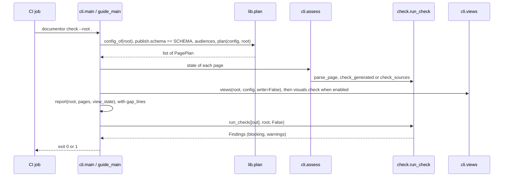

<!-- helix:publish audience=developer page=walkthrough kind=explanation voice=onboarding budget=1100 written=agent-opus reviewed=2026-10-27/agent-sonnet/3e4952e0d168d8d0 -->
<!-- helix:gap artifact:architecture -->
<!-- helix:source src/documentor/cli.py sha256:4fe81cf37df6d5aa -->
<!-- helix:source src/documentor/check.py sha256:784c2473233c0346 -->
<!-- helix:source src/documentor/lib.py sha256:7e594138b133286a -->
<!-- helix:source src/documentor/generate.py sha256:47b5e3e1d2d06cbd -->
<!-- helix:source src/documentor/report.py sha256:0f48cfca412184a2 -->
<!-- helix:source src/documentor/write.py sha256:2118376b2c167085 -->
<!-- helix:source src/documentor/visuals.py sha256:a800032637b6cd3b -->
<!-- helix:source src/documentor/catalog/ci/github-actions.yml sha256:fa22a42e759b3fda -->
<!-- helix:source tests/validate-guide.sh sha256:5c416438f8ca7e20 -->
<!-- helix:source tests/validate-publish.sh sha256:fbe3dede8c6f4a24 -->
<!-- helix:source tests/validate-publish-traits.sh sha256:6f8a932174fe2332 -->
<!-- helix:source tests/validate-write.sh sha256:e7fa04c7257f761e -->
<!-- helix:source tests/python/test_report.py sha256:8952e75926f6350b -->
<!-- helix:source tests/python/test_generators_ops.py sha256:7b51edcbc2916d4e -->
<!-- helix:source tests/python/test_visuals.py sha256:1466ac963c1aef85 -->
<!-- helix:source justfile sha256:33d64f77836eb9e1 -->
# Request walkthrough

## Scenario

The critical request is `documentor check --root .`, which the CI template in `src/documentor/catalog/ci/github-actions.yml` runs on every pull request:

```sh
uvx --from "$DOCUMENTOR" documentor check --root .
```

Take one pull request that edits a source a written page cites. The check must fail, name the page as stale, and need no agent or network.

The repository has no HELIX architecture document; the steps come from the code and tests. [Architecture](architecture.md) describes the parts.

## Sequence

The request reads the configuration, plans the pages, gives each page a state, checks the views and page files, and returns an exit code. A `check` writes nothing to disk.



## Steps and evidence

Each step is one function, and a test under `tests/` proves it against a fixture repository.

1. **Dispatch.** `main` in `src/documentor/cli.py` takes `--catalog DIR`, which sets the HELIX catalog the run reads. It sends tool names in `TOOLS`, such as `check-pages` or `visuals`, to their modules. `check` goes to `guide_main`.
2. **Configuration and plan.** `config_of` reads `.helix.yml`, and `guide_main` refuses a `publish.schema` other than `SCHEMA` in `src/documentor/lib.py`. `plan` builds one `PagePlan` per page from the audiences, the traits, and the project's own pages. It applies the project's `delegate`, `existing`, and `skip` entries.
3. **Page state.** `assess` gives each page one state: delegated, empty, missing, unadopted, stale, unreviewed, or current. It regenerates a generated page in memory and compares the result. For a written page, it compares the source digests, then the `reviewed=` stamp with the body's digest.
4. **Gaps.** `assess` lists a page's `helix:gap` lines as "written without" the missing artifact without changing the page's state. `gap_lines` in `src/documentor/report.py` lists the missing artifacts, the one behind the most pages first.
5. **Source digests.** `check_sources` reads each `helix:source` line. It cuts a `path#anchor` source to that heading's section, so edits elsewhere leave the page current.
6. **Architecture views.** `views` checks the architecture views against the model without rewriting them, and with no model the state is `none`. When `publish.visuals` is set and the views are current, `views` calls `check` in `src/documentor/visuals.py`.
7. **Visuals.** `visuals.check` compares each `umf.visual` document under `<publish.out>/visuals/` with what the model projects. A missing, changed, undrawn, or orphaned document makes the views state `stale`.
8. **Page checks.** `run_check` in `src/documentor/check.py` walks every page under the output directory. It checks sources, kinds, links, backticked paths, cited tests, handling patterns, scope, prose, and unmapped watched files.
9. **Verdict.** `guide_main` prints the report and the counts of blocking findings and warnings. It returns 1 on a blocking finding, an unfinished page, or stale views.

`documentor write` in `src/documentor/write.py` sends a missing or stale page to the writer and an unreviewed page to the evaluator. A page with check findings goes back to the writer.

| Step | Test | What it asserts |
|---|---|---|
| Plan | `tests/validate-guide.sh` | `build` lists the missing tutorial; a skipped audience page is not planned |
| Schema | `tests/validate-guide.sh` | A `schema: 2` block is refused with "reads schema 1" |
| Page state | `tests/validate-guide.sh` | An unevaluated page shows `REVIEW`; a changed source shows `STALE` and fails `check` |
| Gaps | `tests/validate-write.sh` | `status` reports a page written without the architecture artifact |
| Gap order | `tests/python/test_report.py` | The artifact behind the most pages comes first; no gaps, no lines |
| Generated pages | `tests/validate-publish-traits.sh` | A new manifest makes the generated page stale and names the regenerate command |
| Source digests | `tests/validate-publish.sh` | An uncited section's change passes; a cited H2 or H3 change blocks |
| Visuals | `tests/python/test_visuals.py` | A missing document is reported; a changed model label makes it stale |
| Visuals off | `tests/python/test_visuals.py` | Without `publish.visuals`, `enabled` is false |
| Review stamp | `tests/validate-write.sh` | The writer cannot review its own page |
| Evaluation | `tests/validate-write.sh` | The reviewer model evaluates the page the evaluator prompt names |
| Revision | `tests/validate-write.sh` | An unreviewed page with prose findings goes to the writer; a stale page is revised with the moved sources |
| Page checks | `tests/validate-publish.sh` | Broken links, missing paths, handling patterns, and writes outside scope block |
| Verdict | `tests/validate-guide.sh` | A complete, evaluated guide passes `check` |

Two tests cover the request end to end:

```sh
uv run just test-guide
# OK: documentor takes a repository from no guide to a checked, evaluated guide and its site, and catches it going stale
uv run just test-publish
# OK: documentor check-pages stamps, pins staleness to sections, blocks broken links, paths and sources, ...
```

<details>
<summary>The assertions behind the scenario</summary>

From `tests/validate-guide.sh`, after the pages are written, stamped, and reviewed:

```sh
$rg check --root "$p" >"$tmpdir/out" 2>&1 || fail "a complete, evaluated guide should pass: $(cat "$tmpdir/out")"

# A changed source makes the written page stale, and a new plug-in the generated one.
printf '# Vision\n\n## Mission\n\nReview and pay claims.\n' >"$p/docs/helix/01-frame/vision.md"
$rg check --root "$p" >"$tmpdir/out" 2>&1 && fail "a changed source should fail the check"
grep -Eq "STALE +about" "$tmpdir/out" || fail "expected the written page stale: $(cat "$tmpdir/out")"
```

From `tests/validate-guide.sh`, a block for another contract version is refused:

```sh
$rg status --root "$p" >"$tmpdir/out" 2>&1 && fail "a schema documentor does not read should be refused"
grep -q "reads schema 1" "$tmpdir/out" || fail "expected the schema refusal: $(cat "$tmpdir/out")"
```

From `tests/python/test_visuals.py`, the visuals check before writing and after a model change:

```python
self.assertEqual(visuals.check(root, cfg)[0], "visual shop-context is missing; run `documentor visuals`")
...
self.assertIn("shop-context is stale", " ".join(visuals.check(root, cfg)))
```

From `tests/validate-write.sh`, the fake evaluator logs the page path relative to the repository:

```sh
grep -q "^sonnet evaluate docs/guide/developer/index.md$" "$FAKE_LOG" || fail "the evaluator should be the reviewer model"
```

From `tests/validate-write.sh`, an unreviewed page with a five-sentence paragraph goes back to the writer:

```sh
printf '\nOne. Two. Three. Four. Five.\n' >>"$project/docs/guide/developer/developer-guide.md"
: >"$FAKE_LOG"
"$rg" write --root "$project" --agent "$agent" >/dev/null 2>&1 || fail "a page blocked by its checks should be revised"
grep -q "^opus write docs/guide/developer/developer-guide.md$" "$FAKE_LOG" || fail "a page with prose findings should go to the writer"
```

</details>

## Failure paths

Every failure ends in exit 1 with a line naming the page and the next action. Usage errors exit 2.

| Condition | Where it is caught | What the reader sees |
|---|---|---|
| `--catalog` without a directory | `main` | `documentor: --catalog needs a directory ...`, exit 2 |
| `publish.schema` is not the one this release reads | `guide_main` | `... this documentor reads schema 1 ...`, exit 2 |
| No audiences in `.helix.yml` | `guide_main` | ``No guide yet: run `documentor init` first.``, exit 2 |
| An unknown trait id | `load_traits`, via `plan` | `documentor: unknown trait(s) ...`, exit 2 |
| A planned page has no file | `assess` | `MISSING`, with "write it (`documentor write`, or HELIX guide mode)" or "run `documentor build`" |
| A cited source changed | `check_sources` | `STALE`, naming the source that changed |
| A cited source was deleted | `check_sources` | Blocking `missing-source` |
| The body changed after review | `assess` | `REVIEW`: "changed after its evaluation; evaluate it again" |
| A generated page differs from regeneration | `check_generated` | Blocking `stale`: "its sources changed" |
| A broken link or backticked path | `check_links` | Blocking `broken-link` or `missing-path` |
| A cited test the file does not define | `check_tests` | Blocking `missing-test` |
| Text matches a `handling` pattern | `check_handling` | Blocking `handling`, also for drawings beside the pages |
| Views drifted from the model | `views` | `architecture views: stale`, with the problems |
| A visual is missing, stale, undrawn, or has no source | `visuals.check`, via `views` | `architecture views: stale`, with "run `documentor visuals`" |

Prose breaches are warnings in `check`, because `guide_main` calls `run_check` without strict prose. `documentor check-pages --strict-prose` makes them blocking. `documentor write` still sends them to the writer before evaluation.

## Where to change what

Most changes touch one function and one test; extend the test first, then change the code.

| To change | Edit | Prove it in |
|---|---|---|
| Which pages a repository gets | `plan` in `src/documentor/lib.py`, or a trait in `src/documentor/catalog/traits/` | `tests/validate-guide.sh` |
| The configuration schema version | `SCHEMA` in `src/documentor/lib.py` | `tests/validate-guide.sh` |
| A page state or its message | `assess` in `src/documentor/cli.py` | `tests/validate-guide.sh` |
| How gaps are grouped in the report | `gaps` and `gap_lines` in `src/documentor/report.py` | `tests/python/test_report.py` |
| A new check on page files | `run_check` and its helpers in `src/documentor/check.py` | `tests/validate-publish.sh` |
| How a generated page is built | A `@generator` function in `src/documentor/generate.py` | `tests/validate-publish-generators.sh` |
| A CI, task, schema, or compose generator | `ci_pipelines`, `tasks`, `database_schema`, or `compose_services` in `src/documentor/generate.py` | `tests/python/test_generators_ops.py` |
| How a model view becomes a visual, or when it is stale | `documents` and `check` in `src/documentor/visuals.py` | `tests/python/test_visuals.py` |
| Which pages go to the writer or the evaluator | `run` and `write_page` in `src/documentor/write.py` | `tests/validate-write.sh` |
| What the evaluator is told to read | `reviewer_prompt` in `src/documentor/write.py` | `tests/validate-write.sh` |
| When `check` fails | The end of `guide_main` in `src/documentor/cli.py` | `tests/validate-guide.sh` |
| The CI job projects copy | `src/documentor/catalog/ci/github-actions.yml` | No test runs it |
| Voice limits and banned phrases | Synced from HELIX with `just sync-helix`, not edited in `src/documentor/catalog/helix/` | `just test-catalog` |

The Python unit tests run on their own:

```sh
uv run just test-python
```

Run the whole suite before a pull request:

```sh
uv run just test
```

The [Developer guide](developer-guide.md) covers setup, and [Command line](cli.md) lists every command and option.
