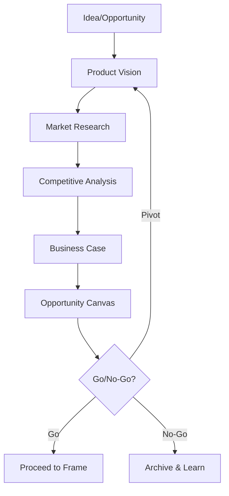

# Activity 00: Discover

Investigate product direction, assumptions, and investment choices.

## Purpose

Discover examines user needs, market evidence, and strategic fit to inform product and investment choices. Use it when those questions affect the decision at hand.

## When to Use Discover

- New product ideas requiring validation
- Market opportunities needing assessment
- Strategic initiatives before resource commitment
- Feature proposals with uncertain business value

## Key Principle

**Evidence Informs Decisions**: Record what is known and what remains an assumption. Research can run alongside authorized requirements, design, and development work.

## Input Gates

Prerequisites to enter this activity:
- **Idea or opportunity identified**: A potential solution, market gap, or user need
- **Sponsor commitment**: Someone willing to champion the investigation

## Exit Gates

Readiness to frame authorized work:
- **Intent clear**: The user need, intended outcome, and scope are understood
- **Uncertainty explicit**: Material assumptions and open product decisions are named

## Artifacts

| Artifact | Purpose | Output Location |
|----------|---------|-----------------|
| Product Vision | Mission, direction, value props | `docs/helix/00-discover/product-vision.md` |
| Business Case | Investment justification | `docs/helix/00-discover/business-case.md` |
| Market Analysis | Market sizing, growth, strategic implications | `docs/helix/00-discover/market-analysis.md` |
| Competitive Analysis | Market positioning | `docs/helix/00-discover/competitive-analysis.md` |
| Opportunity Canvas | Problem-solution fit | `docs/helix/00-discover/opportunity-canvas.md` |
| Current-State Inventory | Evidence-graded register of what already exists | `docs/helix/00-discover/current-state-inventory-[estate-name].md` |
| Data Flow Analysis | As-is documentation of one business process or data flow | `docs/helix/00-discover/data-flow-analysis-[flow-name].md` |
| Component Profile | Cited desk research on one candidate component, with a fit verdict | `docs/helix/00-discover/component-profile-[component-name].md` |
| Resource Summary | Summary of an external source grounding HELIX guidance | `docs/resources/[resource-slug].md` |

## Process Flow

## Human vs AI Responsibilities

### Human Responsibilities
- **Vision setting**: Define mission and strategic direction
- **Market judgment**: Assess competitive positioning
- **Investment decisions**: Approve business case
- **Go/No-Go**: Final decision on proceeding

### AI Responsibilities
- **Research support**: Gather market data and competitor info
- **Analysis**: Structure business case calculations
- **Documentation**: Draft and refine artifacts
- **Gap identification**: Surface missing considerations

## Success Criteria

Discover is complete when:
1. **Vision clarity**: Team can articulate the opportunity in one sentence
2. **Business assumptions**: Investment estimates and uncertainty are explicit
3. **Market understanding**: Competitive landscape is mapped
4. **Problem evidence**: Known needs and untested assumptions are distinct
5. **Decision made**: Clear go/pivot/no-go with rationale

## Next Activity: Frame

Frame translates the selected intent into requirements:
- Define detailed requirements (PRD)
- Create user personas and stories
- Record useful product-learning goals
- Document risks and constraints

---

*Discover prevents building the wrong thing. Frame prevents building it wrong.*
