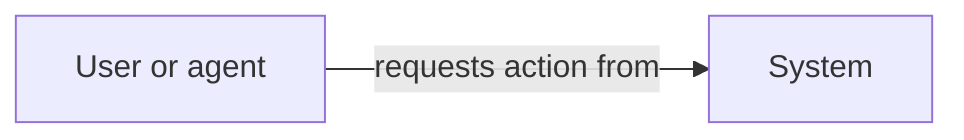

---
ddx:
  id: solution-overview
  authoring:
    home: repo
---

# Solution Overview

## Purpose and audience

[System purpose, reader task, current/proposed state, and governing artifact links.]

## System map

[Question answered and legend: actors, boundaries, and labeled information/action arrows.]

## Parts and boundaries

| Part | Responsibility | Source / authority |
|---|---|---|
| [Part] | [Owned behavior] | [Concrete path or link] |

## Critical flows

[Two or three representative actions. Link one end-to-end architecture walkthrough and its proving tests; distinguish test intent from observed execution.]

## Vocabulary and reading path

[Define unfamiliar terms; order links from overview to walkthrough, developer guide, and deeper references.]

## Maintenance

[Maintainer role, changes that trigger updates, source/link checks, and uncertainty.]
