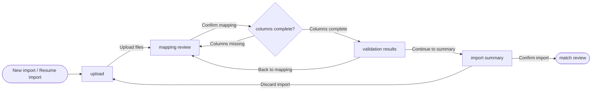

---
ddx:
  id: example.user-flow.depositmatch.csv-import
  authoring:
    home: repo
  depends_on:
    - example.feature-specification.depositmatch.csv-import
    - example.user-story.depositmatch.upload-csv
---

# UF-001: CSV Import User Flow

**Feature**: [[FEAT-001]] CSV Import and Column Mapping | **Solution design**: [[SD-001]] | **Journey maps**: [[UJM-001]]

## Scope

- **Covers**: Upload, mapping review, validation results and the import summary for one client's import session.
- **Entry points**: "New import" on a client's reconciliation workspace; "Resume import" on a draft session.
- **Exits**: Match review (FEAT-002) after the summary is confirmed; back to the client workspace.
- **Size classes**: compact, expanded. On compact, validation results show one rejected row per card instead of a table.
- **Out of scope**: Match review (UF-002).

## Views

| View | Kind | Purpose | Stories | Wireframe |
|---|---|---|---|---|
| upload | screen | Attach this week's bank and invoice CSV files | US-001 | [[UF-001-01-upload]] |
| mapping review | screen | Confirm or adjust which columns hold amount, date and identifier | US-002 | [[UF-001-02-mapping-review]] |
| columns complete? | decision | Check every required column is mapped | US-002 | none |
| validation results | screen | See which rows were rejected and why | US-003 | [[UF-001-03-validation-results]] |
| import summary | screen | Confirm what will be imported before matching starts | US-003 | [[UF-001-04-import-summary]] |
| match review | external | FEAT-002 takes over | none | none |

## Flow Diagram

## Transitions

| Action | From | Control | Guard | To | Feedback | Changed region |
|---|---|---|---|---|---|---|
| Upload files | upload | "Upload" button | both files are CSV | mapping review | Progress per file; a non-CSV file is rejected inline before parsing | full view |
| Confirm mapping | mapping review | "Confirm mapping" button | none | columns complete? | Button busy; second click blocked | action bar |
| Columns missing | columns complete? | none (system) | a required column is unmapped | mapping review | Inline error names each missing column; chosen mappings kept | mapping table |
| Columns complete | columns complete? | none (system) | every required column is mapped | validation results | Validation progress, then the rejected-row count | full view |
| Back to mapping | validation results | "Back to mapping" link | none | mapping review | Mappings shown as last confirmed | full view |
| Continue to summary | validation results | "Continue" button | none | import summary | Summary counts | full view |
| Discard import | import summary | "Discard import" button | none | upload | Toast "Import discarded" with Undo for 10 s | full view |
| Confirm import | import summary | "Confirm import" button | not already confirmed | match review | Button busy; toast "Import confirmed"; match suggestions start | full view |

## Alternate Paths

| Path | Trigger | Transitions | Recovery |
|---|---|---|---|
| Error | A required column is not mapped | Confirm mapping → Columns missing | Map the column and confirm again; other mappings kept |
| Error | Confirming the import fails to save | Confirm import | Inline error with "Try again"; nothing is imported until it succeeds |
| Cancel | The reviewer abandons the import | Discard import | Undo in the toast restores the draft session |
| Empty | Every row is rejected | Columns complete → validation results | "Continue" is disabled with the reason; "Back to mapping" stays available |
| Permission denied | Cannot occur: anyone who can open a client's workspace can import for it | none | none |

## Story Traceability

| Journey | Task | Stories / ACs | Path |
|---|---|---|---|
| import weekly files | Import a client's weekly files | US-001-AC1, US-002-AC1, US-003-AC1 | Upload files → Confirm mapping → Columns complete → Continue to summary → Confirm import |
| import weekly files, wrong file type | Import a client's weekly files | US-001-AC2 | Upload files rejected; stays on upload |
| import weekly files, missing column | Import a client's weekly files | US-002-AC2 | Upload files → Confirm mapping → Columns missing → Confirm mapping |

## Dead Ends

- None. Match review is FEAT-002's flow (UF-002).
