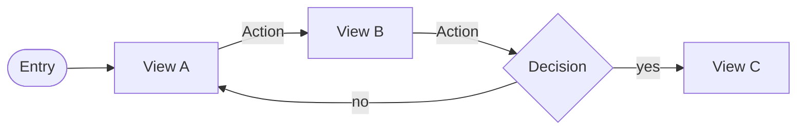

---
ddx:
  id: UF-XXX
  authoring:
    home: repo
  depends_on:
    - FEAT-XXX
    - US-XXX
---

# UF-XXX: [Feature Name] User Flow

**Feature**: [[FEAT-XXX]] | **Solution design**: [[SD-XXX]] | **Journey maps**: [[UJM-XXX]] or none

## Scope

- **Covers**: [The views this feature owns]
- **Entry points**: [Where people arrive from: a navigation destination, a deep link, a notification]
- **Exits**: [Where the flow hands off: another feature, an external system, sign-out]
- **Size classes**: [compact, medium, expanded] [Note where the flow differs by size class]
- **Out of scope**: [Adjacent flows owned elsewhere, by UF ID]

## Views

<!-- Kind: screen | modal | panel | turn (voice or chat) | external | decision.
One row per view, named by what it is. Each view other than external and
decision gets a wireframe, UF-XXX-NN-view, in this folder. -->

| View | Kind | Purpose | Stories | Wireframe |
|---|---|---|---|---|
| [view name] | screen | [The one task this view serves] | [US-XXX] | [[UF-XXX-01-view-name]] |

## Flow Diagram

<!-- Views and transitions match the tables. Label each edge with its action.
Use a diamond for decisions and a stadium for entry and exit. -->

## Transitions

<!-- One row per transition, named by its action. Control: what the person
activates. Guard: the condition, or none. Feedback: what the person sees during
and after. Changed region: full view, or the part that changes. -->

| Action | From | Control | Guard | To | Feedback | Changed region |
|---|---|---|---|---|---|---|
| [Action] | [view] | [control] | [condition or none] | [view] | [progress / success / error / undo] | [full view or region] |

## Alternate Paths

<!-- Every action that can fail, be cancelled, return nothing or be denied.
Name the transitions the path uses, or say why it cannot occur. -->

| Path | Trigger | Transitions | Recovery |
|---|---|---|---|
| Error | [What fails] | [Action → Action] | [How the person recovers; is their input kept?] |
| Cancel | | | |
| Empty | | | |
| Permission denied | | | |

## Story Traceability

<!-- Journey: the journey's name. Task: the feature specification's Task Model
row it carries out. Path: the named transitions in order. -->

| Journey | Task | Stories / ACs | Path |
|---|---|---|---|
| [journey name] | [task name] | [US-XXX-AC1, US-XXX-AC2] | [Action → Action → view] |

## Dead Ends

- [A view with no exit, an unreachable view or an unresolved branch, or "None"]
