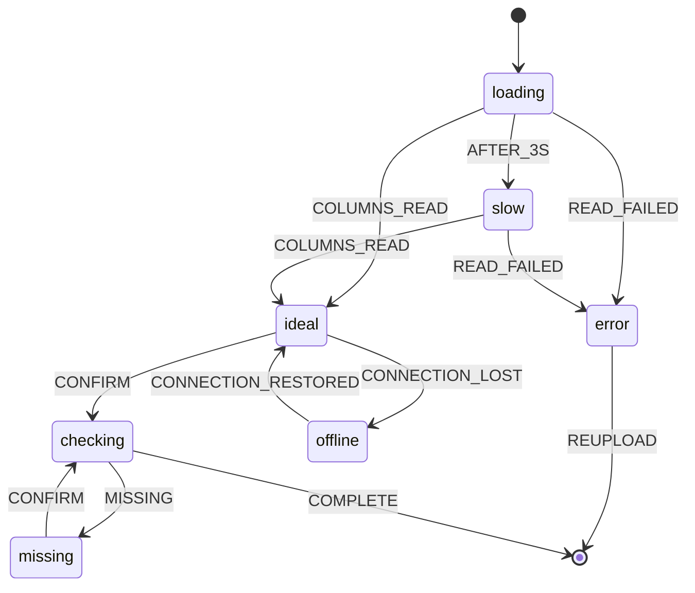

---
ddx:
  id: example.wireframe.depositmatch.mapping-review
  type: wireframe
  authoring:
    home: repo
  depends_on:
    - example.user-flow.depositmatch.csv-import
---

# UF-001-02-mapping-review: Mapping Review

**User flow**: [[UF-001]] view `mapping review` | **Stories**: [[US-002]]

## Scope and Fidelity

- **View**: Confirm which columns hold amount, date and identifier in each file before rows are validated.
- **Modality**: screen
- **Fidelity**: mid
- **Size classes**: compact, expanded
- **Pattern**: Form with a mapping table

## Layouts

### Expanded

```text
┌─────────────────────────────────────────────────────────────┐
│ [Back to client]   Acme Dental · Import 2026-05-08          │
├──────────────────────────────┬──────────────────────────────┤
│ [Bank file mapping]          │ [Invoice file mapping]       │
│  Amount  → [column picker]   │  Amount  → [column picker]   │
│  Date    → [column picker]   │  Date    → [column picker]   │
│  ID      → [column picker]   │  ID      → [column picker]   │
│ [Sample rows]                │ [Sample rows]                │
├──────────────────────────────┴──────────────────────────────┤
│ [Saved mapping note]                      [Confirm mapping] │
└─────────────────────────────────────────────────────────────┘
```

### Compact

```text
┌──────────────────────────┐
│ [Back to client]         │
│ [File tabs: Bank|Invoice]│
│ [Bank file mapping]      │
│  Amount → [column picker]│
│  Date   → [column picker]│
│  ID     → [column picker]│
│ [Sample rows]            │
├──────────────────────────┤
│ [Confirm mapping]        │
└──────────────────────────┘
```

### Annotations

| Element | Kind | Annotation | Size classes | Links |
|---|---|---|---|---|
| Back to client | control | Returns to the client workspace; the draft session is kept. | all | none |
| File tabs | control | Switches between the bank and invoice mappings. | compact | none |
| Bank file mapping | region | One column picker per required field, preselected from the saved mapping when there is one. | all | US-002-AC1 |
| Invoice file mapping | region | As for the bank file. Beside it on expanded; behind the tab on compact. | differs | US-002-AC1 |
| Column picker | control | Lists the file's column headers. A required field left empty is flagged when the mapping is confirmed. | all | US-002-AC2 |
| Sample rows | content | The first five rows under the chosen columns, so a wrong pick is visible before import. | all | none |
| Saved mapping note | content | "Using the mapping saved on 2026-05-01. Changes are saved when you confirm." | expanded | US-002-AC1 |
| Confirm mapping | control | Checks the required fields and starts validation. Busy while checking; blocks a second click. | all | UF-001 Confirm mapping |

## States and Events

### States

| State | Applies | Entered when | Person sees | Available actions | Announcement | Exit |
|---|---|---|---|---|---|---|
| ideal | yes | Columns read from both files | Pickers, sample rows | Pick columns, Confirm mapping, Back to client | none; focus on the heading | CONFIRM |
| empty | no: both files are already attached when this view opens | | | | | |
| loading | yes | View opens | Skeleton pickers | Back to client | none; focus on the heading "Loading columns" | COLUMNS_READ, READ_FAILED |
| partial | no: both files' columns are read together | | | | | |
| error | yes | A file's columns cannot be read | "We couldn't read the invoice file's columns" and the reason | Upload again, Back to client | "Couldn't read the file's columns" (assertive) | REUPLOAD |
| offline | yes | Connection lost | Banner "You're offline; mappings are kept"; Confirm mapping disabled | Pick columns, Back to client | "You're offline" (polite) | CONNECTION_RESTORED |
| slow | yes | Loading takes longer than 3 s | Skeleton and "Still reading columns" | Back to client | "Still reading the files" (polite) | COLUMNS_READ, READ_FAILED |
| permission-denied | no: anyone who can open the workspace can import | | | | | |
| success | no: a confirmed mapping moves straight to validation results | | | | | |
| checking | yes | Confirm mapping pressed | Confirm mapping busy | none; checking takes under a second | "Checking the mapping" (polite) | COMPLETE, MISSING |
| missing | yes | A required field is unmapped | Inline error naming each missing field; picks kept | Pick columns, Confirm mapping | "Amount is not mapped in the invoice file" (assertive) | CONFIRM |

### Statechart



### Events

| Event | From | Guard | To | Effect |
|---|---|---|---|---|
| AFTER_3S | loading | none | slow | Show "Still reading columns" |
| COLUMNS_READ | loading, slow | none | ideal | Preselect the saved mapping |
| READ_FAILED | loading, slow | none | error | Focus moves to the error message |
| REUPLOAD | error | none | final | User flow returns to upload |
| CONFIRM | ideal, missing | none | checking | Check required fields |
| MISSING | checking | a required field is unmapped | missing | Focus moves to the first missing picker; picks kept |
| COMPLETE | checking | every required field is mapped | final | Save the mapping; user flow goes to validation results |
| CONNECTION_LOST | ideal | none | offline | Disable Confirm mapping |
| CONNECTION_RESTORED | offline | none | ideal | Enable Confirm mapping |

## Accessibility

- **Focus order**: Back to client, File tabs (compact), each column picker in the bank file then the invoice file, Confirm mapping.
- **Accessible names**: each picker is named by field and file ("Invoice file: amount column").
- **Headings and landmarks**: h1 "Map columns for Acme Dental"; each file's mapping is a labelled region.
- **Target size and input**: pickers and Confirm mapping at least 44 × 44 px on coarse input.

## Open Questions

- Should the saved mapping note appear on compact? Product decides; it is hidden there today to keep the pickers above the fold.
