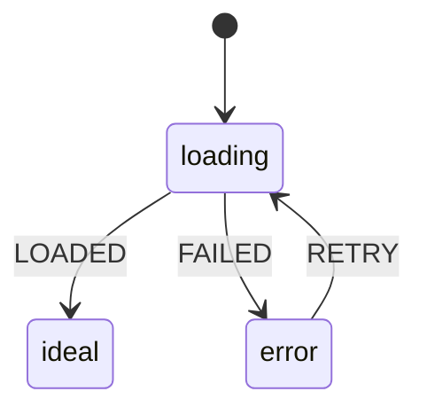

---
ddx:
  id: UF-XXX-NN-view-name
  type: wireframe
  authoring:
    home: repo
  depends_on:
    - UF-XXX
    - US-XXX
---

# UF-XXX-NN-view-name: [View Name]

**User flow**: [[UF-XXX]] view `[view name]` | **Stories**: [[US-XXX]]

## Scope and Fidelity

- **View**: [What this view is for: its one task]
- **Modality**: [screen | voice | chat]
- **Fidelity**: [sketch | low | mid | high]
- **Size classes**: [compact, medium, expanded]
- **Pattern**: [Design-system or SDK pattern, if one is used]

<!-- Annotation depth by fidelity:
sketch: the idea each region serves.
low: layout decisions: regions, order, what is primary.
mid: functionality: what each control does, validation, where it goes.
high: interaction, exact content, every state, accessibility. -->

## Layouts

<!-- One layout per size class. Label elements on the drawing by name and keep
the words in the Annotations table. Use an image under assets/ or a box
drawing. For voice or chat, the layout is the turn: what the system says, what
the person can say or choose, and the confirmation. -->

### [Size class]

```text
┌──────────────────────────────┐
│ [Header]                     │
├──────────────────────────────┤
│ [Main region]                │
│                              │
│ [Primary action]             │
└──────────────────────────────┘
```

### Annotations

<!-- One row per element, named as on the drawing. Kind: region | control |
content | feedback. Every interactive element has a row. Links: the user-flow
transition it triggers, an acceptance criterion, or a DESIGN.md token. -->

| Element | Kind | Annotation | Size classes | Links |
|---|---|---|---|---|
| [Element] | [region / control / content / feedback] | [What it is for or does, at the stated fidelity] | [all, or which] | [transition, US-XXX-ACn, token] |

## States and Events

### States

<!-- Every standard state either applies or is excluded with a concrete
reason. Add view-specific states (saving, streaming, editing) as needed.
Announcement: the text a screen reader hears and its politeness (polite or
assertive), or the focus move that carries the change. -->

| State | Applies | Entered when | Person sees | Available actions | Announcement | Exit |
|---|---|---|---|---|---|---|
| ideal | yes | [event or condition] | [What is shown] | [Actions, or "none" and why] | ["Text" (polite)] | [Events that leave] |
| empty | [yes / no: reason] | | | | | |
| loading | | | | | | |
| partial | | | | | | |
| error | | | | | | |
| offline | | | | | | |
| slow | | | | | | |
| permission-denied | | | | | | |
| success | | | | | | |

### Statechart



### Events

| Event | From | Guard | To | Effect |
|---|---|---|---|---|
| [EVENT] | [state] | [condition or none] | [state] | [What the system does: request, focus move, input kept] |

## Accessibility

- **Focus order**: [Elements in order]
- **Accessible names**: [Icon-only and ambiguous controls with their names]
- **Headings and landmarks**: [View heading, regions]
- **Target size and input**: [Touch targets on coarse input; keyboard shortcuts]

## Open Questions

- [A layout, content or state decision still open, and who decides, or "None"]
