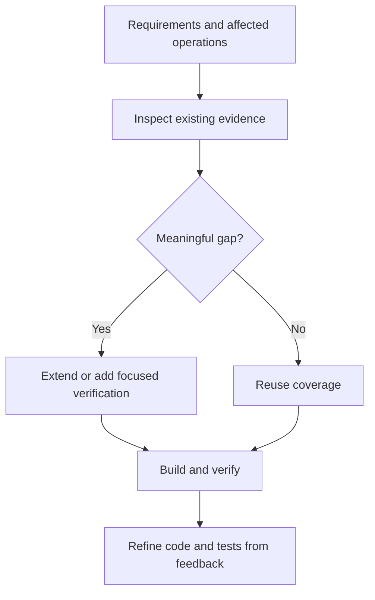

# Activity 03: Test

The verification activity where we select meaningful evidence for required behavior and resolve gaps in existing coverage.

## Purpose

The Test activity establishes how governing behavior will be verified. Inspect existing tests and the affected operations first, then address uncovered behavior or material risks. Execution feedback may simplify both the implementation and its verification.

## Key Principle

**Tests Verify Governing Intent**: Tests encode expected behavior and remain subject to review. Preserve meaningful behavioral evidence while revising or retiring tests of superseded implementation details.

## Workflow Principles

This activity operates under the HELIX workflow principles, emphasizing:

- **Test-First Development**: Use failing behavioral tests when they establish missing behavior or reproduce a defect
- **Specification-Driven**: Tests are derived from Frame and Design specifications
- **Quality Gates**: Apply existing project checks; a blanket Red state is not required before Build
- **Human-AI Collaboration**: Humans govern intent; agents assess coverage and address meaningful gaps
- **Iterative Refinement**: Tests evolve with specifications through the cycle

Verification follows requirements and risk. Passing tests do not establish that an implementation mechanism is necessary or economical.

## Input Gates

Prerequisites to enter this activity (defined in `input-gates.yml`):

1. **Relevant design choices and constraints are clear**
   - Requirement: Architecture and API contracts fully specified
   - Validation: manual review checklist or manual review checklist
   - Source: 02-design activity

2. **User stories have clear acceptance criteria**
   - Requirement: Each story has testable Given/When/Then scenarios
   - Validation: All stories in `docs/helix/01-frame/user-stories/` have criteria
   - Source: 01-frame activity

3. **Non-functional requirements defined**
   - Requirement: Performance, security, scalability metrics specified
   - Validation: NFRs documented with measurable targets
   - Source: 01-frame activity

4. **Security architecture completed**
   - Requirement: Security controls and architecture documented
   - Validation: Security architecture and threat model address scoped risks
   - Source: 02-design activity

Apply these prerequisites to the scoped work and its selected concerns; reuse existing decisions and verification rather than generating another full test matrix.

## Process Flow



## Work Items

### Artifacts (Template-Based Outputs)

#### 1. Test Plan
**Artifact Location**: `artifacts/test-plan/`
**Output Location**: `docs/helix/03-test/test-plan.md`

Testing strategy scoped to requirements and risk:
- Test scope and objectives
- Test coverage targets and rationale
- Testing pyramid (unit, integration, e2e ratios)
- Test environment specifications
- Resource planning and responsibilities
- Risk analysis and mitigation
- Entry and exit criteria

#### 2. Story Test Plan
**Artifact Location**: `artifacts/story-test-plan/`
**Output Location**: `docs/helix/03-test/test-plans/TP-XXX-*.md`

Story-scoped verification handoff for one bounded technical design:
- Governing user story and technical design references
- Acceptance-criteria-to-test traceability
- Concrete new or existing tests, commands, or file targets
- Fixtures, mocks, seed data, and environment needs
- Edge cases and explicit out-of-scope boundaries
- Build sequencing notes for the implementation handoff

#### 3. Test Procedures
**Artifact Location**: `artifacts/test-procedures/`
**Output Location**: `docs/helix/03-test/test-procedures.md`

Step-by-step test execution guide:
- Test writing procedures for each type
- Execution and validation procedures
- Environment setup instructions
- Test data management
- Quality checklists
- Troubleshooting guides

#### 4. Test Suites
**Artifact Location**: `artifacts/test-suites/`
**Output Location**: `tests/`

Test templates and generators:
- Contract test templates
- Integration test patterns
- Unit test scaffolds
- E2E test frameworks
- Acceptance test scenarios

#### 5. Security Test Suite
**Artifact Location**: `artifacts/security-tests/`
**Output Location**: `tests/security/`

Comprehensive security testing specifications:
- **Authentication and authorization test cases**
- **Input validation and injection prevention tests**
- **Data protection and encryption validation**
- **Session management and CSRF protection tests**
- **SAST/DAST integration and configuration**
- **Compliance validation test scenarios**

## Artifact Metadata

Each artifact directory can include a `meta.yml` file that defines:
- **Dependencies**: Links to Frame/Design artifacts that inform test creation
- **Test Coverage Requirements**: Minimum coverage levels for different test types
- **Validation Rules**: Quality checks for test completeness
- **Output Mappings**: Where generated tests should be placed
- **Variables**: Project-specific values for test generation

This metadata enables automated validation and ensures tests align with specifications.

### Actions (Prompt-Only Operations)

#### 1. Write Unit Tests
**Action Location**: `actions/write-unit-tests/`

Create granular tests for individual components:
- Pure function tests
- Class method tests
- Module interface tests
- Mock external dependencies
- Error condition handling

#### 2. Write Integration Tests
**Action Location**: `actions/write-integration-tests/`

Test component interactions:
- Service integration tests
- Database interaction tests
- API endpoint tests
- Message queue tests
- Real service dependencies (per SDD Article IX)

#### 3. Write End-to-End Tests
**Action Location**: `actions/write-e2e-tests/`

Complete user flow validation:
- Critical path scenarios
- Cross-browser testing setup
- Mobile responsiveness tests
- Performance under load
- Data persistence verification

#### 4. Write Performance Tests
**Action Location**: `actions/write-performance-tests/`

Validate non-functional requirements:
- Load testing (concurrent users)
- Stress testing (breaking points)
- Latency measurements
- Resource consumption monitoring
- Scalability verification

#### 5. Write Security Tests
**Action Location**: `actions/write-security-tests/`

Security validation testing:
- Authentication flow tests
- Authorization boundary tests
- Input validation tests
- SQL injection prevention
- XSS protection verification
- API rate limiting tests

## Alignment with Spec-Driven Development

This activity embodies SDD principles from `docs/resources/spec-driven.md`:

### Test-First Practice
- **Reuse evidence**: Existing tests may already exercise the scoped behavior
- **Red-Green-Refactor**: Use a failing test for missing behavior or a regression where useful
- **Behavior-driven**: Verify observable outcomes without freezing implementation details

### Integration-First Testing (Article IX)
- **Real over mocked**: Use actual services where possible
- **Contract-first**: API contracts drive test creation
- **Production-like**: Test in environments matching production

### Specification Traceability
Every test traces to specifications:
- Frame requirements → acceptance tests
- Design contracts → contract tests
- User stories → e2e tests
- NFRs → performance/security tests

## Human vs AI Responsibilities

### Human Responsibilities
- **Test Strategy**: Decide coverage levels and priorities
- **Edge Case Identification**: Think of unusual scenarios
- **Test Review**: Validate test correctness and completeness
- **Performance Targets**: Set acceptable thresholds
- **Business Logic Validation**: Ensure tests match intent

### AI Assistant Responsibilities
- **Test Refinement**: Reuse, extend or consolidate tests against governing behavior
- **Coverage Analysis**: Identify untested paths
- **Test Structure**: Organize tests properly
- **Assertion Writing**: Detect distinct meaningful failures with clear assertions
- **Mock Generation**: Build necessary test doubles

## Quality Gates

Before proceeding to Build activity, ensure:

### Test Completeness
- [ ] All user stories have acceptance tests
- [ ] Changed API contracts have meaningful existing or new coverage
- [ ] Critical paths have e2e tests
- [ ] Material in-scope failure risks have appropriate coverage
- [ ] Error scenarios covered

### Test Quality
- [ ] Tests are readable and maintainable
- [ ] Tests follow AAA pattern (Arrange, Act, Assert)
- [ ] No implementation details in tests
- [ ] Tests are deterministic (no flaky tests)
- [ ] Performance benchmarks defined

### Test Infrastructure
- [ ] CI/CD pipeline configured
- [ ] Test runners working
- [ ] Coverage reporting enabled
- [ ] Test data management planned
- [ ] Environment configuration complete

## Common Pitfalls

### ❌ Avoid These Mistakes

1. **Testing Implementation Instead of Behavior**
   - Bad: Testing private methods or internal state
   - Good: Testing public interfaces and outcomes

2. **Over-Mocking**
   - Bad: Mocking everything, testing nothing real
   - Good: Integration tests with real dependencies

3. **Unclear Test Names**
   - Bad: `test1()`, `testUserFunction()`
   - Good: `should_reject_invalid_email_format()`

4. **Missing Edge Cases**
   - Bad: Only happy path tests
   - Good: Boundary conditions, error states, nulls

5. **Ignoring Non-Functional Requirements**
   - Bad: No performance or security tests
   - Good: Load tests, penetration tests, accessibility tests

## Exit Criteria

Apply `GATE.yaml` and the testing and verification concerns. Existing or new
coverage must address governing criteria at the appropriate layer. A new failing
test is useful for missing behavior; passing tests for existing behavior are
valid. Keep required infrastructure operational and observed run evidence
available. No new suite is required merely to populate a test category.

## Next Activity: Build

Build implements the governing behavior, verifies it, and simplifies code and
tests as execution clarifies the design. Passing tests alone cannot justify
unnecessary mechanisms.

## Test Organization Best Practices

### File Structure
```
tests/
├── unit/                 # Fast, isolated component tests
│   ├── models/          # Data model tests
│   ├── services/        # Business logic tests
│   └── utils/           # Utility function tests
├── integration/         # Component interaction tests
│   ├── api/            # API endpoint tests
│   ├── database/       # Database operation tests
│   └── services/       # Service integration tests
├── contracts/          # API contract validation
│   ├── rest/           # REST API contracts
│   └── graphql/        # GraphQL schema tests
├── e2e/                # End-to-end user journeys
│   ├── critical/       # Critical path tests
│   └── features/       # Feature-specific flows
└── acceptance/         # Business requirement validation
    └── stories/        # User story tests
```

### Naming Conventions
- **Unit Tests**: `{component}.test.{ext}` (e.g., `user-model.test.ts`)
- **Integration Tests**: `{feature}.integration.test.{ext}`
- **E2E Tests**: `{journey}.e2e.test.{ext}`
- **Test Names**: Use descriptive names like `should_reject_invalid_email_when_creating_user()`

### Coverage Requirements

Use project coverage targets and the existing requirement mappings. Select layers
by the behavior and risk they establish, reusing tests across criteria when their
assertions support it. Unit, integration and E2E tests each have a place; no layer
needs a duplicate suite merely to match a generic pyramid.

## Tips for Success

1. **Think Behavior, Not Code**: Write tests for what, not how
2. **Start with Contracts**: API contracts provide clear test targets
3. **Use Real Services**: Avoid mocks when possible (SDD Article IX)
4. **Test the Unhappy Path**: Errors and edge cases matter
5. **Keep Tests Simple**: Complex tests hide bugs
6. **Follow AAA Pattern**: Arrange, Act, Assert structure
7. **Focused Scenarios**: Group related assertions when splitting would duplicate setup and evidence

## Using AI Assistance

Test prompts live under `workflows/activities/03-test/artifacts/`, with
activity-local helper prompts under `workflows/activities/03-test/actions/`.
Open the relevant prompt, use the adjacent template, and keep outputs in
`docs/helix/03-test/` plus executable files under `tests/`.

Common entry points:
- `artifacts/test-plan/`
- `artifacts/story-test-plan/`
- `artifacts/test-suites/`
- `artifacts/security-tests/`

Agents assess existing evidence and address distinct coverage gaps. Review
confirms that assertions reflect governing behavior and that redundant tests or
implementation details have not become obstacles to simplification.

## File Organization

### Structure Overview
- **Test Definitions**: `workflows/activities/03-test/`
  - Templates and prompts for test creation
  - Test planning documents

- **Generated Tests**: `tests/`
  - `tests/unit/` - Unit tests
  - `tests/integration/` - Integration tests
  - `tests/contract/` - Contract tests
  - `tests/e2e/` - End-to-end tests
  - `tests/acceptance/` - Acceptance tests

This separation keeps test templates reusable while organizing actual tests logically in the project.

---

*The Test activity defines success. What follows in Build is simply making that definition reality.*
