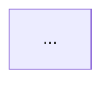

# Visuals: when to draw, and what

A visual is worth drawing when it answers one question a reader has faster than words can. This
reference decides whether an artifact draws one and which. How it looks is
[`diagram-design.md`](diagram-design.md); how an architecture model holds its facts is
[`architecture-model.md`](architecture-model.md).

The vocabulary is DocumentDrivenDX/umf's `umf.visual` 1.0 (CONTRACT-083 in that repository):
seven kinds, each with a few forms. A visual is one kind in one form. DocumentDrivenDX/ux-builder
draws it (`@ux-builder/visuals`) in the project's theme; documentor produces it from the
project's sources and places it on the project's site.

## When a visual earns its place

Draw one only when all three hold:

1. **There is structure prose cannot carry.** Three or more things with relationships, an order,
   a change of state, or numbers, which would take more than three sentences to say.
2. **It answers one question the page's reader has.** Write that question down (the block's
   `question`). If you cannot write it, do not draw.
3. **It comes from a governed source.** The architecture model, an artifact's structured
   section, or a generator's input. When the artifact is itself the source (an ADR's options),
   the visual is drawn from that section and nothing else.

Otherwise write a sentence, a list, or a table. A table is the right answer for "what does each
piece do": the architecture model's `cast` view stays a table.

## Which kind answers which question

| The reader asks | Kind | Form |
|---|---|---|
| What are the parts, and what connects them? | `flow` | `network` |
| What stages does this go through, in order? | `flow` | `pipeline` |
| Where does each part run, and what travels between them? | `flow` | `zoned` |
| What is my first map of this system? | `flow` | `lanes` (a field guide plate) |
| What happens, step by step, when someone does X? | `sequence` | `lifelines`; `ladder` on a narrow page |
| Where does each piece sit? | `structure` | `stack` |
| What is this made of? | `structure` | `tree` |
| What contains what? | `structure` | `nested` |
| What does the data look like? | `structure` | `entities` |
| What states can this be in? | `state` | `machine` |
| What is this thing's normal life, and where can it fail? | `state` | `lifecycle` |
| What happens when? | `timeline` | `milestones` |
| What runs alongside what, over time? | `timeline` | `roadmap` |
| What happened, in order (a narrow page)? | `timeline` | `history` |
| Which option, and why? | `comparison` | `matrix` |
| Where do the options fall on two measures? | `comparison` | `quadrant` |
| What changed? | `comparison` | `before-after` |
| Is this number good? | `metric` | `stat` |
| How do these compare? | `metric` | `bar` |
| How has it changed? | `metric` | `line` |
| How far toward the target? | `metric` | `meter` |

When a question needs two kinds, draw two visuals. A visual holds at most fifteen parts and
aims for five to seven; past that, split it.

## Which visuals each artifact type draws

An artifact type lists the visuals it usually needs in its `meta.yml` under `visuals:`, each as
`{kind, form, question, source}` (`workflows/artifact-schema.md`). Authoring draws each one that
earns its place by the rules above, and only those; the list is a guide, not a quota.
`validate-instance.py` warns when an instance draws a kind and form its type does not list:
either the type's list should grow, or the visual belongs in another artifact.

## How a visual is written in an artifact

A fenced `visual` block with a stable id: lowercase letters, digits, and hyphens, unique in the
document, unchanged across edits (pages, sites, and walkthroughs refer to it). Its body is YAML:
either a reference to the governed source that draws it, or the visual itself.

````markdown
```visual id=checkout-deployment
source: architecture-model.toml#deployment
```
````

````markdown
```visual id=storage-options
kind: comparison
form: matrix
question: Which store holds the session, and why?
```
````

documentor draws visual blocks when the project sets `publish.visuals` (`publishing.md`). Without
it, the same place holds a Mermaid block whose first line names the id, so the move to visual blocks
replaces it by id:

````markdown

````

`validate-instance.py` checks every visual block: an id that is present, well formed, and
unique (Mermaid ids included); a body that names a `source` or a `kind`, `form`, and
`question`; and a form that belongs to its kind.

## Never

- A hand-drawn picture of something a model or an artifact already holds: it drifts, and nothing
  says when. Generate it.
- Color, size, or position in the block: the theme and the renderer decide those.
- A visual whose question is "what is in this document": that is a table of contents.
